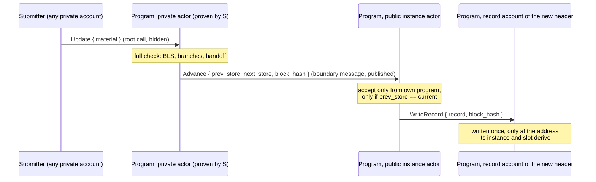

# Caisson: RFP-021 submission

Paste each block below into the matching field of the
[RFP proposal form](https://github.com/logos-co/rfp/issues/new?template=proposal.yml).
Replace every `TODO` first. The form's issue body is capped at 65,536 characters.

Built from `lez-hello-world` `rfp-021/proposal-draft.md`. Evidence links are pinned to
`vineetpant/lez-hello-world@eb686e9` and `hu55a1n1/logos-explorations@d035841`.

---

## RFP ID

RFP-021 — Trustless Ethereum State Attestation for LEZ

## Your Project Name

Caisson

## Team or Organization Name

Congruence Labs

## Primary Contact

TODO (team): email, Telegram, Discord or Signal

## Team Members

Member 1
Name or pseudonym: Chirag Mahaveer Parmar
Social links: TODO
Role: TODO
Status: TODO

Member 2
Name or pseudonym: Shoaib Ahmed
Social links: TODO
Role: TODO
Status: TODO

Member 3
Name or pseudonym: Vineet Pant
Social links: TODO
Role: TODO
Status: TODO

## Project Summary

A caisson is the sealed foundation a bridge pier is sunk on. Caisson is the verified anchor
that LEZ programs build on when they act on Ethereum, RFP-022's bridge among them.
Repository: [github.com/congruence/caisson](https://github.com/congruence/caisson), MIT and
Apache-2.0.

RFP-022's bridge, and any LEZ program that acts on Ethereum, needs one primitive: proof that a
fact holds on finalized Ethereum, verified by LEZ itself, with no committee or oracle to trust.

We build that primitive as one LEZ 0.4 program.

- **Updates are proven, not split.** An update carries the sync-committee BLS12-381 aggregate,
  the finality branch and the committee handoff. It runs on a private actor of the program,
  proven by whoever submits it, and lands as **one** transaction.
  - Measured on `v0.4.0-rc1` with a real mainnet update (E1): **419,311 exec gas** (4.2% of a
    block) and **224,063 storage gas**.
  - Measured again on a running v0.4 devnet, end to end through the fee path: a handoff update
    and a finality update each landed in one transaction, for a net charge of 5,378,064 and
    5,643,360 ([node runs](https://github.com/vineetpant/lez-hello-world/blob/eb686e9a0b2a8cef05f0017aa9eb694ad5212346/rfp-021/results.md#node-runs-eth_lc-on-a-lez-v04-devnet-real-proofs)).
  - Executing the same check publicly costs 11.2M cycles (finality only) to 12.8M (with
    handoff). That's over the 10M cap of one transaction, so it splits in two: 4.9M to prepare,
    7.8M for the pairing (B3, B6, measured). That's about **30× more** exec gas.
  - It needs no multi-transaction job protocol and no precompile.
- **The module checks the aggregate itself (F.1).** It does so inside LEZ's own execution
  proof, so no second proof system is added. This matches the RFP's own reasoning when it
  dropped the off-chain prover: "LEZ execution is already proven".
- **A public path is kept.** The same verifier core also runs publicly, split across
  transactions. It answers the central feasibility question with measurements (P.2, P.8), and
  it lets anyone submit with only a consensus endpoint and LEZ gas.
- **Consumers attest in their own transaction, publicly or privately.** A private attestation
  keeps the query inside the proof. One message crosses the boundary, a check that the
  header record is held, sent from a blinded alias (F.8).
- **Any finalized block, not just recorded ones,** so the instance needs only two updates per
  sync-committee period. The EIP-2935 history contract reaches the 8,191 blocks before a record,
  a parent-hash chain of headers reaches any block with no dependency at all, and beacon
  `historical_summaries` reach further back.
- **The Ethereum side is built by someone who worked on it.** All fetching and local
  verification go through the Logos Ethereum core module, which wraps the Nimbus verified
  proxy that Chirag Mahaveer Parmar worked on. That covers the upstream APIs the module still lacks
  (light-client objects, raw `eth_getProof` nodes), the operator daemon and the F.9
  checkpoint-verification API.

## Technical Approach

#### Evidence

Every number below is **measured**, **derived** from measured numbers with the arithmetic
shown, or marked **to measure**. A number becomes "measured" only after a run we watched.
The evidence is in two repositories, pinned to the commits this proposal cites. Both are
private while they are prepared for release, and will be public before review.

- **Experiment E1**, by Shoaib Ahmed: [[`logos-explorations/rfp-021/e1`](https://github.com/hu55a1n1/logos-explorations/tree/d035841b1efe484db91956eee2a9f47b305dcba3/rfp-021/e1)](https://github.com/hu55a1n1/logos-explorations/tree/d035841b1efe484db91956eee2a9f47b305dcba3/rfp-021/e1). Real proofs on
  LEZ `v0.4.0-rc1`, through the sequencer's own settlement code: the proven-update mechanism,
  its fee, and its refusals.
- **The `eth_lc` prototype and its measurements**, by Vineet Pant:
  [`lez-hello-world`](https://github.com/vineetpant/lez-hello-world/tree/eb686e9a0b2a8cef05f0017aa9eb694ad5212346). A LEZ v0.4 devnet (Bedrock, sequencer, indexer) running
  deploy, Init, two updates and public and private attestations on live mainnet data with real
  proofs, 3–6 Nov 2026.
  - [Results](https://github.com/vineetpant/lez-hello-world/blob/eb686e9a0b2a8cef05f0017aa9eb694ad5212346/rfp-021/results.md), with raw logs in
    [`rfp-021/results/`](https://github.com/vineetpant/lez-hello-world/tree/eb686e9a0b2a8cef05f0017aa9eb694ad5212346/rfp-021/results)
  - [LEZ `v0.4.0-rc1` code paths and their costs](https://github.com/vineetpant/lez-hello-world/blob/eb686e9a0b2a8cef05f0017aa9eb694ad5212346/rfp-021/code-paths.md)
  - [Benchmark plan and the conditions for a timed run](https://github.com/vineetpant/lez-hello-world/blob/eb686e9a0b2a8cef05f0017aa9eb694ad5212346/rfp-021/bench-plan.md)
  - Native tests: the adversarial suite (VS.1, VS.2) and history proofs, in
    [`tests/`](https://github.com/vineetpant/lez-hello-world/tree/eb686e9a0b2a8cef05f0017aa9eb694ad5212346/tests)

The prototype runs `sextant-core`, the light-client verifier from the Sextant prototype
([edenbd1/lez-sextant](https://github.com/edenbd1/lez-sextant), MIT OR Apache-2.0), vendored
unmodified, and its program design follows Sextant's LEZ v0.3 program. Section 11 covers what
the delivered module reuses.

#### 1. Two things called "light client"

| | Operator's light client | On-chain verifier and state |
|---|---|---|
| What | Logos Ethereum core module (Nimbus `libverifproxy`) on the operator's machine | The attestation program's verifier code (image ID) plus its public instance and header-record actors |
| Job | Follow Ethereum, fetch updates, committee keys and inclusion proofs | Decide what LEZ accepts as a finalized Ethereum header |
| Trusted by LEZ | No. It is untrusted data delivery. | Yes. Every LEZ node checks it. |

The heavy computation moves to the operator. The trust decision stays on LEZ.

- The proof must be for the deployed program's image.
- `Advance` is accepted only from the program's own actor (`from_own_program()`). LEZ ties the
  proof to the deployed image, so it can't come from a lenient fork.
- `Advance` is accepted only on top of the store the instance currently holds.

#### 2. State

Each **instance** is a public actor of the program. It holds:

- the checkpoint, chain ID, fork schedule and finality parameters, written once at Init and
  never changed (F.9, F.13)
- the current and next committee roots, which are **32 bytes each**; the 512 keys are never
  stored
- the latest finalized header

Its ID is `H(checkpoint ‖ config)`. That makes IDs impossible to squat, and lets several
instances (mainnet, Sepolia, Hoodi) coexist under one program (F.14, F.15).

**Header records** are immutable accounts, 184 bytes of state each:

- the instance, chain ID, slot, beacon root, block number, `state_root`, `receipts_root`, and
  the execution block hash, which history proofs start from (section 8); the signer count is
  added in M1 (section 10)
- at an address derived from the program, the instance and the slot, so anyone can find a
  record and no one holds a key to it
- written once, only by the program, only after a verified update
- never rewritten or removed, so an old statement stays valid forever (R.3), and every action
  reads at most one record (P.9)

#### 3. Update: what has to be proven

An update must show all of the following:

1. An attested header from the current period.
2. At least 2/3 of the current committee signed it. The supplied keys must hash to the stored
   root.
3. The finality branch from the attested header to the finalized one.
4. The execution branch from the finalized header to `state_root` and `receipts_root`. For
   Gloas, `execution_block_hash` is proven at gindex 2856.
5. At a handoff, the next-committee branch inside the attested state.

A proof of new keys alone is never enough. The new keys are trusted only because the current
committee signed a header containing them:

```
checkpoint → R_N → signs H → H contains R_{N+1} → …
```

Liveness needs at least one handoff per sync-committee period (27.3 h). A missed period stops
the instance, and recovery is a fresh instance (F.10).

#### 4. Update path A: proven (the operating mode)



Measured in E1 on `v0.4.0-rc1`:

| | Toy update (12.6M cycles) | Real mainnet update with handoff (12.9M cycles) |
|---|---|---|
| Public part | 9,547 cycles | 14,768 cycles |
| Exec gas charged | 419,311 (409,764 flat + public part) | 424,532 (derived: 409,764 + 14,768) |
| Storage gas | 224,063 | 224,063 |
| Proving time | 895 s, 13.0 GB peak | **995 s, 14.1 GB peak** |
| Transaction size | — | 227,451 B |
| Update material | — | 52 KB, stays off-chain |

Both were proven on an Apple M3 Max CPU with 64 GB of RAM.

Other E1 results:

- Forged `Advance` (from another program) is refused.
- Stale store is refused.
- A replayed transaction is refused.
- A blinded sender settles. Operators blind their account so the boundary message doesn't
  reveal it.
- **A losing racer is charged its full reserve.** That is what drives the deferral design in
  section 9.

Proving time splits into about 233 s of fixed circuit overhead plus about 760 s for the BLS
check. On a mid-range laptop (M3 Pro, 18 GB, CPU) the same proof takes **1,834 s (30.6 min)**
at the default segment size and swaps about 5 GB (B1, measured). Smaller segments trade time
for memory (B2, measured): 5.3 GB peak in 34.6 min at 2^19, 3.9 GB in 48 min at 2^18. So an
8 GB laptop can operate the module on CPU. A finality-only update, the common case, proves
about 12% faster than one with a handoff (B3: 30.3 against 34.6 min at 2^19). GPU proving is to
measure in M0.

**On a running node** ([node runs](https://github.com/vineetpant/lez-hello-world/blob/eb686e9a0b2a8cef05f0017aa9eb694ad5212346/rfp-021/results.md#node-runs-eth_lc-on-a-lez-v04-devnet-real-proofs)), with our prototype program `eth_lc`,
live mainnet updates and real proofs, on the reference laptop at the default segment size:

| | Handoff update, 510 signers | Finality update |
|---|---:|---:|
| Proving + submit | 2,249.6 s (37.5 min) | 2,167.0 s (36.1 min) |
| Peak memory | 8.6 GB | 9.3 GB |
| Public part (`Advance`, plus the record write when the update finalizes a new header) | 38,431 cycles | 71,593 cycles |
| Net charge (reserve − refund) | **5,378,064** | **5,643,360** |

Times and memory are from the 3 Nov runs, on a quiet laptop. Cycles and charges are from the
final design, with record accounts and block hashes, on 6 Nov ([final design](https://github.com/vineetpant/lez-hello-world/blob/eb686e9a0b2a8cef05f0017aa9eb694ad5212346/rfp-021/results.md#the-final-design-and-attestations-to-older-blocks-6-nov). The proven work is the same in both; the
6 Nov times were slowed by the machine (a busy devnet node, sleep), so they aren't used.

The private fee is (409,764 + public cycles) × 8 + 224,063 × 8, so it is nearly flat: the
proven work isn't metered, and only the public part varies. Both updates were confirmed by
reading the instance and the new record account back. `eth_lc`'s public part is larger than
E1's because it writes a record account; the finality update creates one, the handoff update
here finalized nothing new and didn't.

**Catch-up:** one private execution can verify several consecutive periods, so a stalled
instance resumes in one transaction (R.7). To be measured.

#### 5. Update path B: public split (fallback and measurement)

- The same verifier crate runs as public actor messages, spread across blocks. Each step must
  fit `MAX_GAS_EXEC` = 10M, which caps both a transaction's gas limit and a whole block.
- Measured split (B6): **prepare** runs every check except the pairing (4.93M cycles, hands
  over 741 bytes), then **pairing** (7.85M). Two transactions in two blocks, at least 20 s.
- Where the cycles go (B7): the pairing is 61% of an update and hash to G2 9%, even with the BLS
  accelerator. A pairing precompile is the main lever (P.8).
- It needs no prover, so anyone can advance the instance with only a consensus endpoint and LEZ
  gas (F.11, S.7).
- It produces the public numbers for P.2 and the precompile comparison for P.8. A precompile is
  reachable only from public transactions.
- **Both paths write the same header record.** Consumers can't tell which path wrote it.

#### 6. Attestation

The consumer program builds the predicate. The user or relayer supplies only the Ethereum proof.

- **Public:** the consumer's message to the program runs on the sequencer, with an MPT check
  and predicates. Measured on mainnet vectors (B13): a receipt log costs 52–69k cycles, and a
  storage slot plus its account 190k (0.5–1.9% of the 10M cap, P.1). Each extra predicate
  costs about 1k.
- **Private:** `AttestPrivate` runs on a private actor of the program, inside the consumer's
  private transaction.
  - The query, the Ethereum proof and the predicates are evaluated inside the proof and never
    published.
  - **One message crosses the boundary:** `CheckRecord { record, block_hash }`, a synchronous
    call to that record's account. The account accepts it only from the program's own actors,
    only at the address its instance and slot derive, and refuses unless it holds that record.
    It carries the header record and nothing about the query.
  - **The sender is blinded.** The private actor presents a fresh alias for each message
    (`AccountId::blinded`, a new factor every time), so the consumer's account is never
    published and two attestations by one consumer can't be linked through it.
  - **Fees don't link either.** Refunds return to the fee payer's blinded alias, never to a
    public account.
  - **The check can't go stale.** Header records are immutable, so a record held when the
    consumer proves is still held at inclusion (R.11).
  - **What is published:** the program, the instance, which header record was used, and the
    time. To keep the record from narrowing down the event, consumers attest against the newest
    record and reach the event's block through history proofs (section 8). What is left is
    "proved after that header", which the submission time already shows.
  - **Alternative considered:** reading the record with a cross-boundary state read instead of
    a call. It would publish the same thing, the record and a blinded reader, so it gains no
    privacy. We use `CheckRecord` because it runs on v0.4 today.
  - **F.8 evidence (M2):** every boundary crossing of a private attestation enumerated, and the
    full public state diffed before and after.
- **Measured on a running node** ([node runs](https://github.com/vineetpant/lez-hello-world/blob/eb686e9a0b2a8cef05f0017aa9eb694ad5212346/rfp-021/results.md#node-runs-eth_lc-on-a-lez-v04-devnet-real-proofs)), WETH storage slot plus account
  against a header the instance verified, real proofs, reference laptop:

  | | Public | Private |
  |---|---:|---:|
  | Exec gas | 220,141 (2.2% of the cap) | 21,017 public cycles; the rest is proven |
  | Transaction size | 7,378 B | — |
  | Charge, accepted | **1,820,152** | **5,238,752** net |
  | Time | included in 8–14 s | 751.5–876.1 s proving + submit |
  | Peak memory | — | 7.5–9.0 GB |
  | Charge, refused | **16,059,024** (the whole gas limit) | 0: nothing is submitted |

  Charges are for the final design: record accounts with block hashes (6 Nov). The ring-based
  prototype of 3–4 Nov cost 1,853,184 and 5,271,592.

  - Honest attestations were accepted on both paths. A tampered proof and a false claim were
    refused on both: reverted in their block on the public path, unprovable on the private
    one, so the wallet never sent them. A header the instance never verified was refused on
    the private path.
  - On the public path a refusal is charged the whole gas limit, 8.8× an accepted one. So the
    CLI dry-runs the check before submitting and stops on a refusal (U.2, measured). Setting a
    tight gas limit as well is M3 work.
  - **The design above, on the node** ([what it publishes](https://github.com/vineetpant/lez-hello-world/blob/eb686e9a0b2a8cef05f0017aa9eb694ad5212346/rfp-021/results.md#what-a-private-attestation-publishes-f8)).
    The private attestation crossed the boundary with one `CheckRecord` call from a one-time
    alias, plus the fee reserve to the fee inbox from another, and its refund went to the
    payer's alias. A search of the whole transaction, proof included, found none of the
    wallet's private accounts, the payer, the queried address, the slot or the proof leaves.
    The reserve amount is public; it is priced from the transaction's public part, so it
    reveals nothing about the query.
  - **Not tested:** a modified wallet that skips the local run and submits anyway. The
    sequencer would then run the record check itself.
  - **Minimum spec for a consumer's private attestation (P.4),** which is the proving a
    Basecamp user's own machine does. Measured peak: 7.5–9.0 GB at
    the default segment size, 12.5–14.6 min on the reference laptop (M3 Pro, 18 GB, CPU). We
    declare 16 GB of RAM, CPU proving, as the supported minimum today, with a light desktop
    load: with two browsers open, the reference laptop swapped and a proof took about 3×
    longer. Smaller segments brought an update down to 3.9 GB (B2); the same setting is
    measured for the attestation in M2, aiming at 8 GB.
- **Verified once, used many times.** Attestation never re-verifies an update or its
  signature. It trusts a header record because only the program writes it, and only after
  verification.
- **R.11 (independent submissions):** header records are immutable and attestation writes no
  shared state. Several private attestations can land in one block, and each can compute its
  result before inclusion.

#### 6b. Recorded statements and batching (soft #1, #2)

Neither is built or measured yet. Both are designed so they add no second verification path.

**Recorded statements (soft #1).** A `Record` instruction runs the same `evaluate` call as
`Attest`, against the same header record, and writes the resulting statement to a write-once
account at an address derived from the instance and the statement ID.

- **One verification core.** The direct path and the recorded path call one function, so the
  audit surface and the cost profile stay common. The cost is the B13 attestation cost plus one
  new account. For scale, a new header record account (184 B) added about 146k to an update's
  net charge on the node (decision D8). A statement account is of similar size.
- **What a reader trusts.** Only the program can write the account, and only after the check,
  so a reader trusts the program, not whoever paid for the write. A reader is still acting on a
  result computed in an earlier transaction, which the direct path never asks of it (F.7). The
  consumer docs say so, and recommend the direct path wherever the attestation's cost isn't the
  constraint.
- **Privacy.** The recorded statement is public by design. A consumer that needs F.8 uses the
  private direct path.

**Batching (soft #2).** `Attest` and `Record` take a list of queries over one header record.
The record is read once, its check against the instance is made once, and each query costs only
its own Merkle-Patricia proof and predicates. On the private path, a batch is one proof and one
`CheckRecord` crossing for all its queries, so it publishes no more than a single attestation.
To measure in M2: the per-query saving on the public path, and proving time against batch size
on the private path.

#### 7. Predicates and statements

A consumer sends a **query**: the chain ID it expects, one inclusion proof, and a list of
predicates that must all hold. The program returns a **statement**: its ID, the chain ID, the
block number and the predicates that held. The consumer builds the query. The module never
changes to support a new one (F.4).

**What the prototype runs today** (`sextant-core`'s `statement.rs`, every measured attestation):

- **Fields:** account balance and nonce, a storage slot's value, a log's address, its topic
  *i*, and its 32-byte data word *i*.
- **Values:** 32-byte big-endian words, compared as unsigned integers.
- **Comparisons:** `= ≠ < ≤ > ≥`, ANDed over the predicates of one proof.
- **A reverted transaction's logs** are refused (`PredicateFalse`), since they prove nothing
  happened.

**Added in M2, for the delivered interface:**

- **Fields:** account code hash, a byte offset and width for packed slots, a log's topic count
  and data length.
- **Values:** signed integers (two's complement) and addresses as typed values, beside raw words.
- **Compound statements (soft #4):** AND over several proofs under one header, such as an
  account balance plus a storage slot, in one statement.
- **Helpers:** Solidity mapping-slot derivation in the client library, so consumers don't
  compute storage keys by hand.

**Statement IDs carry a nullifier-safety class** (F.6, S.4). Each ID is a domain-separated
hash, so the two classes can never collide:

- **Log statements:** an ID over the chain ID, the block, the transaction index, the log index
  and the log content. There is one ID per occurrence, so it is safe as a one-shot nullifier.
  The prototype keys the block by number. The delivered interface keys it by the execution
  block hash, which the header record already carries, so an ID means the same thing whichever
  instance produced it.
- **State statements:** an ID over the chain ID, the address, the slot and the attested values.
  The same state gives the same ID at any finalized block, as F.6 requires, so the same value at
  two different times collides.
  - The docs mark these IDs "unsafe as a one-shot nullifier unless the slot is write-once".
  - The reference vault uses a write-once deposit mapping.

**Same verdict off-chain.** The CLI's dry run calls the same `evaluate` function, compiled
natively, so a query refused on-chain is refused off-chain with the same code (U.2).

**Reference consumers (U.6):**

- **ERC-20 deposit:** a `Transfer` log to the vault.
- **Native ETH:** the vault's `receive()` emits `Deposit(sender, amount, nonce)`.
  - `msg.sender` is the real sender, including Safe, ERC-4337 and EIP-7702 accounts.
  - No transaction-trie parsing and no secp256k1 recovery sit in the trusted path.

**Typed errors (U.5).** Every refusal is one code, the same in the program, the CLI's dry run
and the docs:

| Failure mode (U.5) | Code |
|---|---|
| Header not finalized | `NotFinalized` |
| Sync-committee signature invalid | `BadSignature`, `BelowParticipation` |
| Committee handoff not verified | `HandoffNotVerified`, `BadCommitteeBranch`, `CommitteeMismatch` |
| Checkpoint stale or wrong | `CheckpointStale`, `CheckpointMismatch` |
| Inclusion proof invalid | `BadInclusion`, `BadExecutionBranch` |
| Predicate not satisfied | `PredicateFalse` |
| Chain-ID mismatch | `ChainMismatch` |
| Malformed input | `Malformed`, `BadKey` |
| Update already applied (R.8) | `AlreadyApplied` |

Measured on the node: the CLI's dry run of a public attestation returns the code the program
refuses with (`BadInclusion` for a tampered proof, `PredicateFalse` for a false claim), and
stops before submitting. v0.4 blocks record that a transaction reverted but not why, so the dry
run is also where a consumer reads the code.

#### 8. Historical state (soft #3)

An attestation can target any finalized block, not only one the instance recorded. That is
what lets the instance run on two updates per period (section 9).

- **Primary, the 8,191 blocks before a record: EIP-2935.** The history contract, live since
  Pectra on mainnet, Sepolia and Hoodi, keeps the last 8,191 block hashes in state. A storage
  proof under the record's `state_root` gives the target's block hash. The target's RLP header,
  which must hash to it, gives its `state_root` and `receipts_root`, and the attestation
  proceeds against those. It is the same storage-proof code a slot attestation uses, plus the
  RLP decode the verifier already has for Gloas.
- **Fallback, any distance: a parent-hash chain.** The consumer supplies the headers from the
  record back to the target, each checked against its child's `parentHash`. It depends on
  nothing but Ethereum's header hashes, so it also covers a chain without EIP-2935 (F.14). The
  cost grows with the distance, about one keccak and 600 bytes a block. On the public path that
  suits short gaps; on the private path the work is inside the consumer's proof, which the fee
  doesn't meter, so it costs proving time only.
- **Older than about 27 h:** beacon `historical_summaries`.
- **Measured on the node** ([final design](https://github.com/vineetpant/lez-hello-world/blob/eb686e9a0b2a8cef05f0017aa9eb694ad5212346/rfp-021/results.md#the-final-design-and-attestations-to-older-blocks-6-nov), real proofs, 6 Nov):

  | Target | Public | Private |
  |---|---:|---:|
  | The record's own block | 1,820,152 (220k exec gas, 7.4 KB) | 5,238,752 |
  | 1,000 blocks back, EIP-2935 | **3,288,376** (397k exec gas, 13.7 KB; 4.0% of the cap) | **5,238,752** |
  | 3 blocks back, parent-hash chain | **2,507,576** (303k exec gas, 10.0 KB; 3.0% of the cap) | **5,238,752** |

  All accepted, all publication checks passed (the target's header and history slot are not
  in the transaction), and a forged history header was refused on both paths
  (`BadExecutionBranch`). In private, reaching an older block costs nothing extra: the history
  proof is checked inside the consumer's proof, the published part is the same `CheckRecord`,
  and proving took the same 803–810 s.
- **Also tested natively** ([`tests/history.rs`](https://github.com/vineetpant/lez-hello-world/blob/eb686e9a0b2a8cef05f0017aa9eb694ad5212346/tests/history.rs), 6 tests,
  passing, on pinned mainnet blocks). EIP-2935 reaches a block 50 back from the record, and a
  parent-hash chain one 3 back. A forged header, the slot of another block, another contract,
  a target outside the window, a broken link and the wrong anchor are each refused. The
  record carries its execution block hash, verified inside the update's proof, so the chain
  starts from a hash the program checked.

#### 9. Operator daemon (U.3, R.4, R.5, R.8–R.10)

The daemon is a Logos module plus a Logos Core headless CLI.

- It follows Ethereum through the core module and tracks the instance from LEZ events
  (LP-0012).
- **Cadence: two updates per sync-committee period (27.3 h), 642 a year.**
  - the mandatory handoff
  - one about 13.7 h later, so consecutive records stay well inside the 8,191-block history
    window and every block between them can be proven from the later one (section 8)
  - on demand, for an event newer than the latest record, paid by whoever needs it: about
    0.48M exec gas
  - Tracking costs about 11.3M a period at the base-fee floor, 0.001% of the period's exec
    capacity ([B12a](https://github.com/vineetpant/lez-hello-world/blob/eb686e9a0b2a8cef05f0017aa9eb694ad5212346/rfp-021/results.md#b12a-amortised-tracking-cost-p3)). There is no heartbeat.
- **Re-check before submit (R.9):** a losing racer pays its whole reserve (E1). The daemon
  re-reads the instance immediately before sending and keeps its reserve tight.
- **Deferral (R.10):** a per-instance randomized delay spreads cost across operators.
  Documented with its effect on latency.
- **Restart (R.4, R.5):** the daemon resumes from the instance on LEZ. It never re-verifies from
  the checkpoint and never repeats work already applied.

#### 9b. Operator incentive (soft #5)

Liveness doesn't depend on this. Anyone can still advance an instance by paying the gas. It
gives operators a reason to keep doing so.

- **Pool.** Each instance has a bounty pool: a PDA of the program, seeded by the instance ID.
  Anyone can fund it with an ordinary native-token `Transfer`: consumers, protocols that depend
  on fresh headers, or a grant.
- **Payout.** A successful `Advance` pays the recipient the update names, using
  `custody_transfer` from the pool. The fee program uses the same primitive.
  - The amount is `min(pool, rate × Δslots, cap)`, where Δslots is how far the new finalized
    header is past the previous one.
  - `rate` and `cap` are part of the instance's immutable config.
  - The payout grows with how stale the instance was, measured in Ethereum time, which the
    update itself proves. No LEZ clock read is needed.
- **Why it grows with staleness.** An operator submits once the payout covers its cost (about
  478k exec gas plus storage). Operators with different costs reach that point at different
  moments, which spreads submissions over time instead of starting a race. Frequent tiny updates
  earn tiny payouts, so there's nothing to gain from spamming.
- **Permissionless (F.11).** No registration and no allow-list. Whoever lands the `Advance`
  claims the payout. The `pre_state == prev` check already selects exactly one winner per step.
- **Racing.** A losing submitter still pays its reserve. The bounty doesn't change that, so the
  re-check and deferral of section 9 stay.
- **Attestation fee, optional per instance.** A consumer can add a flat transfer to the pool in
  its own transaction. In a private attestation that is one more boundary crossing. A flat
  amount reveals nothing about the query.
- **Known limits.**
  - The recipient is credited asynchronously, in a later transaction.
  - The payout recipient is public, so a submitter that wants privacy names a fresh account.
  - Funding is voluntary. An unfunded pool pays nothing, and the system behaves as without
    the bounty.

#### 10. Security model (S.6, VS.1–VS.6)

- **Fabricated chain (VS.1):** an explicit adversarial test. A self-consistent header plus
  inclusion proof over state that was never finalized must be rejected.
- **Committee attack cost.** Following the chain through the sync committee trusts that at
  least 342 of its 512 members are honest. Sync-committee signatures are not slashable today,
  so a dishonest signature costs a member little beyond the reward for that slot. There are two
  ways to get 342 signatures on a header that was never finalized:
  - **Luck.** An entity holding stake share *f* draws seats roughly as Binomial(512, *f*). The
    chance of drawing ≥ 342 seats in one period (27.3 h; 321 periods a year):

    | *f* | P(≥ 342) | P(≥ 410) | P(≥ 461) |
    |---|---|---|---|
    | 0.33 | 6e-55 | 4e-106 | 1e-160 |
    | 0.50 | 1e-14 | 5e-45 | 6e-84 |
    | 0.60 | 9e-4 | 2e-22 | 2e-52 |
    | 0.67 | 0.50 | 1e-11 | 3e-35 |

    Below about 50% of stake this is negligible, even over a year of periods. At 60% it is about
    25% per year at the default threshold. An entity with that much stake can already disrupt
    Ethereum consensus itself.
  - **Bribery.** Each committee is known about a period ahead. An attacker can pay 342 members,
    or the few large operators that control many seats, to sign a false header. The cost is
    whatever those members accept, not stake at risk. We state this plainly. Security for
    high-value consumers comes from the defences below, not from a dollar figure.
- **Consumer defences (VS.4).** The record carries the update's signer count (added in M1;
  the prototype's record doesn't have it yet). A consumer chooses its own policy:
  - **A higher participation threshold.** For example, 410 (80%) or 461 (90%). An attacker then
    needs that many seats, which moves the luck columns above by tens of orders of magnitude.
    The four mainnet updates in E1's vectors had 510–512 signers. A larger sample, measured in
    M1, sets how often a high threshold costs liveness.
  - **The two-committee rule.** Act only on a header that the next committee has also built on.
    An attacker then needs supermajorities in two independently drawn committees: the luck
    probability is squared, and the bribe covers two sets of members.
  - **Value caps** per header or per period, for consumers that need neither.
  - **A freeze authority on the consumer side,** as RFP-022 specifies for the bridge: the
    consumer can pause acting on new statements while a suspected committee attack is
    investigated. It lives in the consumer, never in this module, so it can't censor other
    consumers or touch the tracked state.
- **What a compromised committee can and can't do (VS.4).** It can get the instance to record a
  header that was never finalized, and so make false statements verifiable from that record on.
  It can't alter records already written, or statements already consumed, and it can't move the
  instance's checkpoint or config. Exposure is bounded by the consumer defences above. Recovery
  is a fresh instance from a checkpoint before the attack, and consumers rebinding to it (F.10).
- The table is reproducible from the binomial tail:
  `sum(comb(512, i) * f**i * (1 - f)**(512 - i) for i in range(k, 513))`.
- **No swappable verification (VS.3):** no `ProgramId` is held in mutable state. Instances are
  immutable. Migration is to a new program version plus a new instance. The Recommended Consumer
  Pattern (S.4) carries the same rule for consumers. A consumer pins this module's program ID and
  instance at its own deployment. If it kept either in mutable state, whoever controls that
  state could point it at a module that attests to anything. The reference consumers (U.6) pin both.
- **Immutable deployment.** `from_own_program()` compares program addresses, not code, so the
  program is deployed with `ProgramHeader.immutable = true`. LEZ v0.4's loader then refuses
  `UpdateHeader` on it (`program_loader/core/src/lib.rs:93`). Segments and headers are
  write-once, so nothing else in the protocol can change the program. A protocol upgrade of LEZ
  itself is outside this guarantee, and the trust document says so.
- **Config bound to the instance.** The checkpoint, chain ID, fork schedule and participation
  threshold are part of the instance state that `Advance`'s `prev` must match, and part of
  the instance ID. A submitter can't supply a weaker config.
- **Already exercised** ([`tests/adversarial.rs`](https://github.com/vineetpant/lez-hello-world/blob/eb686e9a0b2a8cef05f0017aa9eb694ad5212346/tests/adversarial.rs), 13
  tests, passing, natively on the recorded mainnet vectors, against the verifier our prototype
  runs). Each asserts the exact error, next to an honest control that passes:
  - **VS.1:** a fabricated chain, self-consistent throughout. A fabricated execution state root
    is committed in the finalized header, that header in the attested state, and the attested
    header is signed by all 512 keys of a committee we generated. Refused: `CommitteeMismatch`.
    The control: against a store that trusted that committee, the same update verifies, so the
    refusal comes from the committee chain back to the checkpoint. A fabricated checkpoint
    header: `CheckpointMismatch`.
  - **VS.2:** a committee never handed off (`HandoffNotVerified`), a forged next committee
    (`BadCommitteeBranch`), 341 of 512 signers (`BelowParticipation`), a header not finalized
    (`NotFinalized`), a tampered state or receipts root (`BadExecutionBranch`, and
    `BadInclusion` against a record), a proof replayed to another chain (`ChainMismatch`; an
    update under another chain's domain, `BadSignature`), and a predicate over state the proof
    doesn't cover (`Malformed`; another slot, `BadInclusion`).
  - In M1 the suite also runs through the deployed program on a devnet. The attestation cases
    already do: tampered proof, false claim and unheld record were refused on the node.

#### 10b. Off-chain participants (F.12)

| Participant | What it does | Safety or liveness | If it declines or misbehaves |
|---|---|---|---|
| Checkpoint supplier (whoever runs `Init`) | Picks the weak-subjectivity checkpoint and config | **Safety**, once, at `Init` | A wrong checkpoint gives an instance of the wrong chain. Consumers verify the checkpoint through the core module's API (F.9) before binding to an instance, and a bad instance is never fixed in place, only replaced (F.10, F.13) |
| Beacon API source | Serves light-client updates and committee keys | Liveness | Everything it serves is verified. Any beacon node, ours or public, serves the same data |
| Operator (update submitter) | Proves and submits updates | Liveness | Anyone can submit, with no registration (F.11). The public split path needs no prover, only a consensus endpoint and LEZ gas |
| Execution RPC | Serves `eth_getProof` and receipts | Liveness | Every proof is checked against a verified record. Any archive or full node serves them |
| Consumer's prover (private path) | Proves the consumer's own transaction on the consumer's machine | Liveness, for that consumer only | No third party sees the query |
| Relayer (public path, optional) | Submits a consumer's attestation | Liveness | The consumer can submit it directly |
| Sync committee | Signs headers | **Safety**: the honest-supermajority assumption | Section 10: attack cost and consumer defences |

No participant other than the checkpoint supplier and the sync committee can affect safety, and
each liveness role can be filled by anyone. So no party, alone or as a class, can stop an
attestation from eventually being produced: a consumer who needs a header can fetch the update
and submit it itself.

#### 11. Reuse assessment (R.6)

TODO (team): confirm which base the build uses. The evaluation below is scoped either way.

**What our numbers ran on.** Every update and attestation figure in this proposal, E1's and
ours, ran on `sextant-core`: the light-client verifier from the Sextant prototype for RFP-021
([edenbd1/lez-sextant](https://github.com/edenbd1/lez-sextant), MIT OR Apache-2.0), vendored
unmodified. Our prototype program's design also follows Sextant's LEZ v0.3 program. It
verified real mainnet updates and passes our adversarial suite, but it has not been audited.

**Candidates for the delivered module:**

| Candidate | Audited | Fit with LEZ |
|---|---|---|
| `r0vm-helios` | yes, by zkSecurity | Same zkVM (RISC Zero). Built for EVM destination chains with Solidity contracts, so the LEZ actor, records and attestation are ours to write |
| Helios `consensus-core` | upstream of the audited forks | Plain Rust; needs adapting to run inside a LEZ actor |
| `sextant-core` | no | Already runs as a LEZ v0.4 actor; every number here was measured on it |

**Primitives:** BLS12-381 through RISC Zero's accelerated `blst` fork and `bls12_381`, SHA-256
and Keccak, SSZ, and Merkle-Patricia proof code.

**Evaluation (M0, budgeted):**

- For each candidate: Electra, Fulu and Gloas coverage (gindices, the Gloas execution
  commitment), and whether the audit covers the code paths the program runs.
- Its cycles under LEZ's metering: the B3 and B13 runs repeated on it.
- The work to fit it to the actor model.
- Recorded in the decision log: what we reuse, what we rewrite, and what that leaves for the
  audit (S.8).

**Audit-surface consequence.** Code reused from an audited implementation, on the paths that
audit covered, leaves the audit (M5) with the LEZ-specific code: the actor and its trust
boundary, records, statements and predicates, and the inclusion proofs. Code not covered by an
existing audit, including all of `sextant-core` if it stays, joins that scope.

#### 12. Dependency check against the live runtime

| Dependency | Status | Our handling |
|---|---|---|
| LEZ testnet 0.4 (S.1) | `v0.4.0-rc1` tagged 29 Oct. The public testnet 0.4 is not live as of 2 Nov | Build and measure on the rc now. Run end-to-end tests on a local v0.4 devnet with a standalone sequencer (S.2). Deploy to testnet 0.4 in M4 once it launches. Re-measure on the final 0.4 |
| SPEL IDL (U.4) | SPEL `v0.7.0-rc.3` supports neither LEZ v0.3 nor v0.4 (spel#291) | Hand-written SPEL-format IDL, with a drift check in CI |
| Logos Ethereum core module | No light-client objects or raw `eth_getProof` nodes | Chirag Mahaveer Parmar, who worked on the Nimbus verified proxy, extends it upstream (U.1, F.9) |
| Standalone sequencer + Bedrock (S.2) | No published Bedrock release matches v0.4's pin. Built from source at the pinned commit, it runs: our local devnet (one Bedrock node, sequencer, indexer) ran deploy, Init, updates and attestations on 3–6 Nov | e2e on this devnet. Known issue: the sequencer's Bedrock funding key drains after about 1,350 blocks and must be topped up |

#### Traceability matrix

Every hard requirement maps to a design element and a test or artifact.

| Req | Design | Evidence |
|---|---|---|
| F.1 | Module checks the aggregate in its proven actor | Proof test on mainnet vectors (E1b) |
| F.2 | Finality branch plus participation | Reject-unfinalized test |
| F.3 | Account, storage and receipt-log MPT, roots bound to the record | Inclusion tests; caller-root-ignored test. Node: storage slot accepted, tampered proof refused on both paths ([node runs](https://github.com/vineetpant/lez-hello-world/blob/eb686e9a0b2a8cef05f0017aa9eb694ad5212346/rfp-021/results.md#node-runs-eth_lc-on-a-lez-v04-devnet-real-proofs)) |
| F.4 | Predicate language (section 7) | Consumer-defined predicate test, no module change |
| F.5 | `chain_id` in instance and statement | Same contract on mainnet and Sepolia, cross-rejected |
| F.6 | ID classes (section 7) | Equal-state and distinct-state tests |
| F.7 | Attest inside the consumer's transaction | Reference consumers |
| F.8 | Private attest; one `CheckRecord` crossing from a blinded alias; refunds to the blinded alias | Node: every published field listed, and no private account, payer or query detail in the transaction. Full public-state diff (M2) |
| F.9 | Write-once instance; checkpoint API | Immutability test; core-module API |
| F.10 | Fresh instance on staleness | Migration doc plus stale-instance test |
| F.11 | Any account advances (both paths) | Fresh-account test |
| F.12 | Off-chain participants, safety vs liveness (section 10b) | Table in 10b; trust document |
| F.13 | No rewrite instruction | Interface review plus test |
| F.14, F.15 | `H(checkpoint ‖ config)` instances | Mainnet, Sepolia and Hoodi coexisting |
| U.1–U.3 | Logos modules, CLI, daemon | Module catalog, CLI docs |
| U.4 | Hand-written SPEL IDL | Drift check in CI |
| U.5 | Typed errors (section 7) | Error table. Node: the dry run returns the program's code and stops before submitting |
| U.6 | ERC-20 and native-ETH consumers | e2e tests |
| R.1, R.2 | Deterministic, read-only attest; dry run before submit | Repeat-verdict test. Node: a refused private attest submits nothing; a refused public one is charged its gas limit, so the CLI dry-runs and sets a tight limit |
| R.3 | Immutable record accounts | Node: records written once and read back; post-rotation validity test |
| R.4, R.5 | Daemon resumes from LEZ state | Kill and restart tests |
| R.6 | Reuse assessment (section 11) | Document |
| R.7 | Stalled instance resumes; catch-up | Stall test |
| R.8 | Digest-checked `Advance` | Racing test (E1c) |
| R.9, R.10 | Re-check plus deferral | Multi-operator test |
| R.11 | Immutable records, no shared writes | Same-block private attest test |
| R.12 | CI | Green default branch |
| P.1 | Attest under the per-transaction budget | Cycle report |
| P.2 | Per action: cycles, gas, proof time, proof size | bench-plan.md |
| P.3 | Amortised tracking cost at the recommended cadence | Two updates per period: results.md B12a |
| P.4 | Laptop and minimum-spec proving | Updates: B1, B2. Private attestation on the node: 7.5–9.0 GB; declared minimum 16 GB |
| P.5 | Latency breakdown | results.md B12b: no update wait for a block before the latest record; 49–57 min on demand on the reference laptop |
| P.6 | Daemon and prover resources | Report |
| P.7 | Storage growth over 1 and 5 years | results.md B12c: 118 KB a year, 591 KB over 5 |
| P.8 | In-program vs precompile delta | Report |
| P.9 | No cost scaling with stored state | Node: every action reads one record account by its derived address |
| S.1, S.2 | Testnet 0.4; e2e on a standalone sequencer | Deployment, CI |
| S.3–S.5 | Integration, consumer-pattern and operator docs | Docs |
| S.6 | Trust assumptions document | Doc (section 10) |
| S.7 | Operator role document | Doc |
| S.8 | Audit | M5 |
| S.9, S.10 | Module catalog plus release action | Release |
| S.11 | Decision log | `docs/DECISIONS.md` |
| VS.1–VS.6 | Adversarial suite (section 10) | VS.1, VS.2: `tests/adversarial.rs`, 13 native tests, passing; attestation cases also refused on the node |
| Soft #1 | `Record` on the same `evaluate` core (section 6b) | Shared-core test; recorded-statement doc. To build, M2 |
| Soft #2 | A list of queries per record (section 6b) | Per-query cost and private proving time against batch size. To measure, M2 |
| Soft #3 | EIP-2935 history, parent-hash fallback (section 8) | Node: 1,000 back and 3 back, accepted, real proofs; `tests/history.rs`, 6 tests |
| Soft #4 | Compound statements over one header (section 7) | Prototype: AND of predicates over one proof; across proofs, M2 |
| Soft #5 | Staleness bounty pool (section 9b) | Design; issue #18 |

#### Design decision log (seed entries)

- **D1: Proven update as the operating mode, public split as the fallback.**
  - Why: 1 transaction, about 30× less exec gas (measured, B3/B6), no job state.
  - Cost: prover hardware, plus about 16 min CPU per update on an M3 Max (E1b) and 36–38 min on
    the reference laptop on a running node.
- **D2: Verifier compiled into the program, not an external zk light-client proof.**
  - A LEZ program cannot verify an outside receipt inside its own proof.
  - Public STARK or Groth16 verification is pairing-heavy, and the RFP dropped a second proof
    layer for the same reason.
- **D3: Attest trusts header records and never re-verifies signatures.**
- **D4: Private attest on a private actor of the program; its only boundary crossing is one
  `CheckRecord` call from a blinded alias.** A state read would publish the same and isn't
  shown on v0.4.
- **D5: Instance ID = `H(checkpoint ‖ config)`.**
- **D6: Statement-ID nullifier-safety classes.**
- **D7: Native ETH via a vault log, not the transaction trie.**
- **D8: Header records in write-once accounts derived from the instance and the slot.**
  - Why: an old statement stays valid (R.3), and each action reads one record (P.9).
  - Cost: about 146k per update that writes a record; attestations got about 46k cheaper
    (measured on the node, 6 Nov).
  - Rejected: a bounded ring in the instance, which drops old records.
- **D9: History through EIP-2935, with a parent-hash chain as the fallback.**
  - Why: the instance needs two updates per period instead of one every few hours.
  - Cost, measured: nothing extra on the private path; 1.47M more on the public path for a
    block 1,000 back, 0.69M for one 3 back.
  - Rejected: our own history on LEZ, which needs a record for every reachable block, so more
    updates. Beacon `block_roots`, because the standard Beacon API doesn't serve those proofs.
- **D10: Two updates per period, plus on demand.**
  - Why: liveness (the handoff), coverage (records less than 8,191 blocks apart), and cost.
  - Cost: an event newer than the latest record waits up to 13.7 h, or for an on-demand update.

#### Risks and anticipated challenges

- **Provisional private fees.** `PRIVATE_VERIFY_GAS` is marked `FIXME: Provisional`. If private
  work became metered, D1's advantage would shrink. Path B keeps the system working.
- **Latency, for an event newer than the latest record.** (An older one, within 8,191 blocks,
  needs no update.) On the reference laptop, from the event to a header recorded on LEZ takes
  about 49–57 min: about 13 min of finality, up to 6.4 min for the update to appear, 36–38 min
  of proving, one block. A private attestation adds 13–15 min of proving on top. GPU proving
  (B10) is the main lever; finality time is not ours to change.
- **Operator hardware.** Per update: 36–38 min and 8.6–9.3 GB peak on the reference laptop (M3
  Pro, 18 GB, CPU) at the default segment size, measured on the node; 16.6 min and 14.1 GB on an
  M3 Max (E1b). Smaller segments trade time for memory: 5.3 GB in 34.6 min at 2^19, 3.9 GB in
  48 min at 2^18 (B2). GPU is to measure (B10).
- **Operators without proving hardware.** A prover can't forge an update; it can only fail to
  produce one. So the heavy part can be delegated. The update has two proofs: the program's
  proof, about 760 s of the 995 s in E1b, takes only public update material as input, while the
  privacy circuit's proof, about 233 s, needs the submitter's private keys. The first can go to a
  remote prover while the second stays local. LEZ proves both through one prover today, so this
  needs a daemon-side path or a small LEZ change. Planned in M3 as an option, not a dependency:
  the public split path already needs no prover at all.
- **Refused public attestations are expensive.** v0.4 charges a reverted public transaction its
  whole gas limit, 16,059,024 against 1,820,152 accepted. The CLI dry-runs before submitting.
- **Testnet 0.4 timing.** The public testnet isn't live yet. Everything up to M4 runs on the rc
  and a local devnet. If the launch slips past M4, the deployment moves with it and the rest of
  M4 is delivered on the devnet.
- **Release-candidate drift.** Every node number here is from `v0.4.0-rc1`. The final 0.4 may
  change APIs or the provisional fee constants. Every benchmark is scripted, so re-measuring is
  a re-run, budgeted in M4.
- **Liveness.** A missed handoff stops an instance. Mitigations: multiple operators, alerting,
  on-demand submission, catch-up.
- **A missed mid-period update.** Records can then end up more than 8,191 blocks apart. A
  block in the gap is still reachable through the parent-hash fallback or an on-demand update,
  so it costs latency, not safety.

## Milestones, Payout and Timeline

TODO (team): a USD payout and a duration for each milestone. The build totals 8–12 weeks plus the audit.

| # | Milestone | Weeks | Payout (USD) | Deliverables |
|---|---|---|---|---|
| M0 | Cost baseline | 1 | TODO | Public and proven update numbers, laptop numbers and a GPU number on `v0.4`, reviewed with Logos before the build |
| M1 | Verifier core and updates | 3 | TODO | Light client (Gloas-aware), proven path, public path, Init, instance immutability, VS.1–VS.2 tests, decision log |
| M2 | Attestation | 2 | TODO | Public and private attest, the full predicate interface and statement IDs (section 7), recorded statements and batching (section 6b), ERC-20 and native-ETH reference consumers, F.8 boundary evidence, P.4 laptop numbers |
| M3 | Ethereum side and operations | 2–3 | TODO | Core module extensions, F.9 checkpoint API, daemon (Logos module plus headless CLI), CLI with dry run, history proofs |
| M4 | Testnet and release | 2 | TODO | LEZ testnet 0.4 deployment against a public Ethereum testnet (once launched), all benchmarks re-run on the final 0.4, e2e CI on a standalone sequencer, docs, trust-assumptions document, module catalog release |
| M5 | Audit | — | TODO | Third-party audit of consensus and inclusion logic, plus fixes. Allowance TBD. |

## Total Requested Budget (USD)

TODO (team): the sum of the milestone payouts above.

## Relevant Experience

All three partners worked on Incubed, a light client that verifies Ethereum responses for
devices without a full node. That work is the same problem this RFP poses: deciding what to
accept from an untrusted source using only proofs against a trusted root.

- **Chirag Mahaveer Parmar** worked on the Nimbus verified proxy, which is what the Logos
  Ethereum core module wraps. The upstream extensions this proposal needs from that module
  (light-client objects, raw `eth_getProof` nodes, the F.9 checkpoint API) are changes to code
  he knows.
- **Shoaib Ahmed** worked on Cosmos IBC, where each chain verifies the other's consensus with
  an on-chain light client: the model this module follows on LEZ. He ran the research and
  experiment E1 behind this proposal ([`logos-explorations`](https://github.com/hu55a1n1/logos-explorations/tree/d035841b1efe484db91956eee2a9f47b305dcba3/rfp-021/e1)), which showed a real
  mainnet sync-committee update proven as one private LEZ v0.4 transaction.
- **Vineet Pant** worked on decentralized and self-sovereign identity: proving a claim to a
  verifier without revealing more than the claim, which is the F.8 problem the private
  attestation path solves. He built the `eth_lc` prototype and ran its measurements on a LEZ
  v0.4 devnet ([`lez-hello-world`](https://github.com/vineetpant/lez-hello-world/tree/eb686e9a0b2a8cef05f0017aa9eb694ad5212346)).

TODO (team): links for each item above (GitHub profiles, the Incubed and Nimbus verified proxy
work, Cosmos IBC, identity work).

## Post-Delivery Plan

TODO: owner. Expect a servicing ask: operate an update daemon for a defined period, inside the
budget.

## Permissions and Consent

- [ ] Logos may contact us using the primary contact above (required)
- [ ] Logos may use information from this proposal publicly (optional)

## Program Requirements

- [ ] We have read and agree to the Logos RFP Terms and Conditions (required)
- [ ] RFP specifications are proposals, not instructions; we are responsible for what we build, deploy or operate (required)
- [ ] The project is open-sourced under MIT and Apache 2.0 (required)
- [ ] We are prepared to deliver milestone-based outcomes (required)
