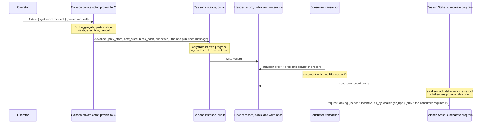
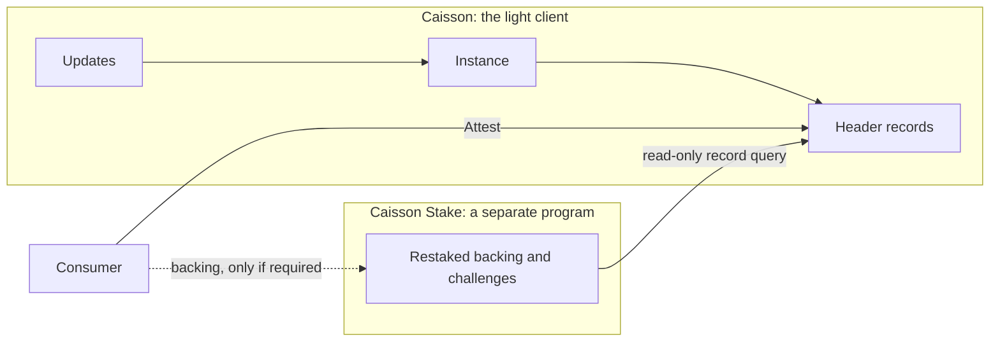

# Caisson: RFP-021 submission

Paste each block below into the matching field of the
[RFP proposal form](https://github.com/logos-co/rfp/issues/new?template=proposal.yml).
The form's issue body is capped at 65,536 characters.

Evidence links are pinned to `vineetpant/lez-rfp021-experiment@eb686e9`,
`hu55a1n1/logos-explorations@c7586ae` (head of `rfp-021-context`), and
`hopinheimer/logos-explorations@df79a16` (head of `eth-lc-core-residue`).

---

## RFP ID

RFP-021 — Trustless Ethereum State Attestation for LEZ

## Your Project Name

Caisson

## Team or Organization Name

Congruence Labs

## Primary Contact

Signal: sufialhussaini.17

## Team Members

Member 1
Name or pseudonym: Chirag Mahaveer Parmar
Social links: https://github.com/chirag-parmar
Status: Contractor

Member 2
Name or pseudonym: Shoaib Ahmed
Social links: https://github.com/hu55a1n1
Status: Contractor

Member 3
Name or pseudonym: Vineet Pant
Social links: https://github.com/vineetpant
Status: Contractor

Member 4
Name or pseudonym: Manas Nagaraj
Social links: https://github.com/hopinheimer
Status: Contractor

## Project Summary

A caisson is the sealed foundation a bridge pier is sunk on. Caisson is the verified anchor
that LEZ programs build on when they act on Ethereum, RFP-022's bridge among them.
Repository: [github.com/congruence/caisson](https://github.com/congruence/caisson), MIT and
Apache-2.0.

Caisson is one LEZ 0.4 program that lets any LEZ program prove a fact about finalized Ethereum,
an account, a storage slot or a log, inside its own transaction, publicly or privately. It trusts
nothing beyond Ethereum's sync committee.

- **Updates:** an operator advances an instance with one private transaction. The program's own
  actor checks the BLS aggregate, finality and the committee handoff; the sequencer verifies one
  receipt.
- **Records:** each applied header is written once to its own account and never changed.
- **Attestations:** a consumer proves inclusion and evaluates its conditions against one record,
  in its own transaction. Privately, only a check that the record is held is published, from a
  one-time alias.
- **Misbehaviour:** a conflicting header or committee signed by a trusted committee freezes the
  instance.
- **Incentives:** operator tips and restaked backing live in a separate, optional program,
  Caisson Stake.

**Key decisions**

| | Decision | Why | Section |
|---|---|---|---|
| D1 | The update runs in a private actor of the program, as one transaction | Even optimized, a public update would take most of a block and make every node re-run the pairing, and the optimized verifier is unaudited; privately the sequencer verifies one receipt for a flat charge. It can move to the public path once audited | 2.2 |
| D2 | Anchor on the sync committee; restaking in a separate program | The committee resists coordination through RANDAO; a consumer that needs resilience to bribery also requires restaked stake | 3.1 |
| | Equivocation freezes the whole instance; evidence must land before the stored side's deadline | Conflicting signatures prove the committee equivocated; the deadline stops expired keys from halting a healthy instance | 3.2 |
| D3 | Instance ID `PDA(program, H(checkpoint ‖ config))`, configuration written once | Can't be squatted or changed; mainnet and testnets coexist under one program | 4.1 |
| D4 | Each applied finalised header written once to its own account | An attestation reads its header (or a history record) and the `Freeze` account, so no cost grows with history | 4.4 |
| D5 | Each fact's ID carries a nullifier-safety class | Logs give one ID per event; state gives the same ID at any block, so consumers know what is safe to nullify | 4.7 |
| | One shared, append-only set of error codes | The program and the module return the same code, so a consumer can match on it | 6 |
| D6 | Any finalized block through canonicality proofs, cheapest via EIP-2935 | A 2.4 KB proof from a history record reaches any of the 8,191 blocks before a record | 7.1 |
| | Incentive amounts come from pluggable policy programs | Caisson Stake can be developed and replaced independently of the light client | 8.2 |

## Technical Approach

### 1. Design Overview

**Components**

- **Caisson program:** a LEZ program, deployed immutable. On the operator's private account it
  runs the full update check (BLS aggregate, participation, finality, execution and handoff
  branches) inside the operator's proof. On public accounts it keeps each instance's
  configuration, consensus state, committees and finalised headers (section 4), and advances
  only on a message from its own program.
- **Finalised header accounts:** one per applied header, written once, never changed.
- **Consumer program:** proves an Ethereum fact against one record and acts on the statement.
- **Caisson Stake program:** a separate LEZ program with its own image ID. It holds stake
  positions, locks backing behind records and settles it. It reads Caisson's records and
  never writes them.

**Roles**

- **Operator:** fetches light-client updates through the Logos Ethereum core module, proves the
  program's update check, and submits one transaction.
- **Sequencer and indexers:** verify the receipt, run the small public part, and charge fees.
- **Restaker (Caisson Stake):** on a consumer's request, checks a header against Ethereum's own
  finality with its own node, then locks stake behind its record, claimed only if the header is
  proven false (section 8).
- **Challenger (Caisson Stake):** watches backed records, and proves a false one against the full
  validator set (future work, section 8.4). Evidence of equivocation only freezes the instance.

Caisson Stake, restakers and challengers make up the restaking side, isolated from the light
client.

**Flow**



The heavy computation sits with the operator. The trust decision stays on LEZ: the proof must
be of the deployed, immutable program, and the instance accepts a new store only from its own
program and only on top of the store it holds.

### 2. Advancing Finality

#### 2.1 Baseline

E1, by Shoaib Ahmed
([`logos-explorations/rfp-021/e1`](https://github.com/hu55a1n1/logos-explorations/tree/c7586ae9ca77addeeadf444ff525a662fc173729/rfp-021/e1)),
ran a real mainnet update with a committee handoff as a private LEZ `v0.4.0-rc1` transaction,
through the sequencer's own settlement code:

| Result | Figure |
|---|---|
| The update check, proven privately | **14,058,921 cycles** |
| Exec gas, through the block fee path | **429,723** (409,764 flat plus the 19,959-cycle public part) |
| Storage gas | **224,063** for the zk receipt |
| Proving (on Apple M3 Max) | 1,107 s, 13.1 GB peak |
| Proving (on RTX 4090, 24 GB, CUDA 12.4, r0vm 3.0.6 built with CUDA) | 30.2 s |

#### 2.2 Optimization

The update verifier is `eth-lc-core`, the light-client crate in
[logos-explorations](https://github.com/hopinheimer/logos-explorations/tree/df79a165d540995237bfc89ab3d959a1c9d49cd0/eth-lc).
Two rounds of changes (0.2 and 0.3) cut a real mainnet update from **14.06M to 6.15M cycles (−56%)**.

The changes, how to reproduce them and all logs are in
[`rfp-021/e1/optimisation`](https://github.com/hopinheimer/logos-explorations/tree/df79a165d540995237bfc89ab3d959a1c9d49cd0/rfp-021/e1/optimisation).

The following points explain the optimization concisely.

- **Committee as a witness (0.2).**
  - Cost removed: hashing both committees' 512 keys each to check their roots.
  - How: the current committee is sent as its keys root, plus each non-signer's key and branch;
    the next committee as its root.
- **Uncompressed points (0.2).**
  - Cost removed: decompressing keys and the signature, which takes square roots.
  - How: points are sent uncompressed; the signature hint is bound to the committed bytes and
    subgroup-checked.
- **One combined Miller loop (0.2).**
  - Cost removed: the two Miller loops, run separately.
  - How: they run as one combined Miller loop.
- **Residue check (0.3).**
  - Cost removed: the pairing's final exponentiation.
  - How: it is replaced by the residue check of [eprint 2024/640](https://eprint.iacr.org/2024/640),
    `f·s = c^λ`, with `s ∈ Fp6`, `c ≠ 0` and canonical coordinates.

All rows below were measured on an Apple M4 Max, so they differ from the E1 run on the M3 Max above.

| Item | 0.1 | 0.2 | 0.3 | Class |
|---|---:|---:|---:|---|
| Real proof, step 1 | 1,247 s | 774 s | **696 s** | measured |
| Peak memory | 8.1 GB | 7.4 GB | **6.6 GB** | measured |
| Update input, kept off chain | 52 KB | 3.1–3.5 KB | 4.0–4.4 KB | measured |
| Direct execution (what a sequencer runs on the public path) | 238–243 ms | 181–186 ms | 134–142 ms | measured |

**Next (estimated):**

- Fold the residue check into our own Miller loop, as gnark does: about 5.4M cycles.
- Add hinted line slopes and square-root hints in hash-to-G2: **about 4.6M–5.0M** cycles.
- A native BLS12-381 pairing precompile in LEZ (public path only; the proven path can't use it):
  about 0.3M–0.5M guest cycles, plus the precompile's gas.

**Decision D1: the update runs in a private actor of the program, proven by the operator, and
lands as one transaction.** At the 14.1M-cycle baseline the check couldn't run publicly at all:
LEZ `v0.4.0-rc1` caps exec gas at 10M (`MAX_GAS_EXEC`), both for one transaction and for the
total of a whole block. Optimized to 6.15M cycles, it fits the public budget,
but two things hold it back:
- one update would still take most of a block's 10M on its own, crowding out every other
  transaction, and every sequencer and indexer that replays the block would re-run the pairing;
- the optimized verifier is unaudited.

So the update takes the private path. Once the optimized verifier is audited, it can move to the
public path.

Run privately, the check runs once, on the operator's prover. The sequencer and every replaying
node only verify the receipt, for a flat charge whatever the private part computed, and run the
19,959-cycle `Advance`: 429,723 exec gas in E1.

### 3. Misbehaviour

#### 3.1 Bribing The Sync Committee

The light-client protocol's default anchor is the sync committee: 512 validators whose
signatures a light client follows instead of the full validator set. This section measures what
stands behind it, how much stake signs each header and how much of it a forger would lose, and
what Caisson adds to it.

**Stake behind a signed header.** Every seat is a validator with an effective balance between 32
ETH (the minimum to activate) and 2,048 ETH (the maximum since EIP-7251). A header needs 342
signatures, so in the worst case a minimal forgery is signed by 342 validators at 32 ETH each:
**10,944 ETH**. Real committees hold more.

**Today, nothing is burned.** The consensus spec has two slashable offences, proposer equivocation
and attester double or surround votes. Sync-committee messages aren't among them, and no fork
through Fulu adds one. A member that signs a fake header for a light client can still sign the
canonical root for its duty, so it doesn't even give up its sync reward, about 0.21 ETH per seat
per period (derived from EIP-8390's issuance figure).

**If sync-committee lies were slashable.** EIP-7657 would slash the signers of conflicting
sync-committee messages with the standard `slash_validator`. Under Electra that burns, per
validator, `effective_balance / 4096` at once, plus a correlation penalty of
`effective_balance × min(3 · S / T, 1)`, where `S` is all stake slashed within about 36 days and
`T` is total stake (about 43.7M ETH, October 2026). The validator is also ejected. In the worst
case, every signer at 32 ETH:

| Signatures the forgery needs | Stake that signs | Burned |
|---|---:|---:|
| 342, the protocol minimum | 10,944 ETH | **11 ETH** |
| All 512 | 16,384 ETH | **22 ETH** |
| 342 in each of two committees | 21,888 ETH | **38 ETH** |

`burned = S × (1/4096 + 3 · S / T)`. The burn is 0.10–0.17% of the stake that signs, because the
correlation penalty scales with the share of *all* stake slashed together. It only takes the
whole balance once a third of all stake is slashed at once, about 14.6M ETH. That is exactly the
Casper FFG case, and exactly what a 512-seat committee can never reach.

**How the anchors compare:**

> **EIP-8390** (draft, created 22 Aug 2026, no fork named) would remove the sync committee and have
> light clients verify a succinct proof of Casper FFG finality over the full validator set,
> moving every header to the FFG row below. Caisson would adopt that anchor as a new program
> version with new instances; records and statements already made stay valid.

| Anchor | Stake that signs a minimal forgery | ETH a forger loses |
|---|---:|---:|
| Sync committee, today | 10,944 | **0** |
| Sync committee, if slashable (EIP-7657, stagnant since 2024) | 10,944 | **11**, plus ejection |
| Casper FFG finality over the full validator set | ≈ 29.1M | **≈ 14.6M** |
| Sync committee plus restaked backing `S` (Caisson Stake, D2) | 10,944 + `S` | **`S`**, once the false-header challenge exists (future work, section 8.4) |

These figures are per header, not per consumer. One forged header exposes every consumer that
accepts its record at once, so what guards a header has to be weighed against the value all of
them place on it together.

**Decision D2: anchor on the sync committee, and ship a basic restaking program beside it that
adds the capital the committee lacks.** The sync committee still protects against coordination
attacks today, because RANDAO draws its seats. To be resilient against bribery, a consumer should
also require restaked stake greater than zero behind the header: a restaker adds stake only once
the full validator set has signed the same header as the sync committee.

So a header in the hybrid is trusted because a randomly drawn supermajority signed it, and stake
may stand behind it. That stake is lost only when a proof against the full validator set shows
the header false, not when two records merely conflict (section 8.4).

Caisson anchors on the sync committee and
adds restaking as a separate program, **Caisson Stake**, isolated from the light client. It only
reads header records, so advancing the sync committee, writing records and attesting work the
same with or without it, and consumers that don't require backing never touch it. Its incentive
functions are pluggable (section 8.2).



#### 3.2 Equivocation

The sync protocol moves its finalized header to any newer slot that a supermajority of the current committee signed. It skips any ancestry check between the old header and the new one. Sync-committee signatures sit outside Ethereum's slashing rules, so a second chain costs the signers only the signatures. We freeze an instance when someone brings evidence that a committee the instance trusts signed a header or a next committee that conflicts with one the instance stored (AKA equivocation).

##### 3.2.1 Evidence

Evidence of misbehaviour can be submitted in its own `Evidence` message. The message carries one light-client update plus the address of the stored account it conflicts with. It is very similar to `Update`: the light-client check is proven privately, against the committee root stored for the signature's period, and the public part checks the conflict against the stored account and writes only the `Freeze` account (section 4.8).

The instance keeps one header per execution block number and one committee per period. Evidence names the stored account by that key.

Each check is one account lookup: the header account stores `block_hash`, `slot` and `beacon_root`, and the committee account stores the root of its period.

The lookups leave one gap. A fork at a new block number inside one period matches neither lookup, so its evidence is refused, and the forged header can still land as an ordinary `Update`. The fix is a `block_roots` proof on the evidence transaction (one header's beacon state holds a different root at the other header's slot). `block_roots` covers 8,192 slots, i.e. one sync-committee period, and the branch is small next to the aggregate check. The same proof covers a fork at the same slot with a different block number. It ships after the lookups. Until then, detection covers conflicts at a stored block number or committee.

##### 3.2.2 Deadline

Evidence must land before the deadline of the stored side it conflicts with: `genesis_time + 12 × slot + weak_subjectivity_period`, in seconds, where `slot` is the stored header's slot or the committee's `handoff_slot`. After the deadline, the committee's keys are expired, and a leaked key could sign a conflict for free. The deadline keeps such late evidence from halting a healthy instance. The LEZ sequencer clock decides when the deadline passes: a late clock extends it, and an early clock closes it.

##### 3.2.3 Freeze

A valid piece of evidence writes one `Freeze` account at a PDA of the instance, and freezes the
instance, not a header. Evidence can name any stored header or committee still inside its
deadline, not only the newest. Every public step that uses the instance (`Advance`, `Attest`, `Record`, `RecordHistory`, and `CheckRecord` on the private path) reads that account and proceeds only while it is unwritten. This adds one fixed read per transaction, so an attestation reads two accounts: its header and `Freeze` (P.9). The read stays constant as history grows.

Freezing stops the instance and leaves every stored account in place. It names the conflict and leaves the choice of chain to consumers. A freeze slashes nobody: stake and request incentives behind the instance's records are returned, unless a false-header challenge succeeds (section 8.4). A consumer moves to a new instance, anchored at a checkpoint before the conflict that `verify_new_checkpoint` accepts.

### 4. Core Data Structures

Each account's object is Borsh-encoded, and stores the values its address is derived from, so it
can recompute its own address and refuse to act anywhere else.

| Object | Once per | Stored as | Passed |
|---|---|---|---|
| Instance configuration | Instance | Public PDA at the instance ID; written once, at `Init` | In `Init`, a public transaction |
| Consensus state | Instance | Public PDA; replaced by each applied update | The operator names the current state; a copy goes into `Update` as private input, the new state out in `Advance` |
| Committee | Sync-committee period | Public PDA, the root only; written once, at `Init` or its handoff | The 512 keys go into `Init` or `Update` as private input, checked against the root; once the optimized verifier is audited, `Update` takes the committee witness instead (section 2.2) |
| Finalised header | Verified header | Public PDA; written once, by the update that finalised it | Public path: `Attest` is sent to it. Private path: private input to `AttestPrivate`, confirmed by `CheckRecord` |
| Predicate | Claim | Not stored | Inside the claim |
| Claim | Consumer transaction | Not stored | Public path: in `Attest`, visible in the transaction. Private path: private input to `AttestPrivate`, never published |
| Verified statement | Holding claim | Not stored, except by `Record` (section 7.2) | Public path: the `Attested` reply and event. Private path: returned inside the consumer's proof |
| Recorded statement | `Record` call | Public PDA at `H("statement" ‖ instance ‖ H(statement))`; written once (section 7.2) | Read by any program, without proofs |
| Update count | Sync-committee period | Public PDA; incremented by each `Advance` | Its value becomes the new header's or race receipt's `rank` (section 8.1) |
| Race receipt | Losing racer | Public PDA; written once, by the racer's `Advance` | Read by `ClaimTip` (section 8.1); never attested against |
| History record | Finalised header, at most once | Public PDA holding the EIP-2935 contract's storage root under that header; written once, by `RecordHistory` (section 7.1) | Named in a claim's `Ancestry`; the slot proof is checked under it |
| Freeze | Instance, at most once | Public PDA; written once, by the first valid evidence | In `Evidence`: the conflicting update as private input, the stored account it conflicts with in the public part |
| Events | Update, freeze or public attestation | In the block's events, not in accounts | Emitted by the program's handlers |

Only the consensus state and the update count are rewritten. Every other account is written once
and never removed, so a statement valid when produced stays valid (R.3), and an unadvanced
instance keeps every header it has verified (R.7).

#### 4.1 Instance Configuration

**Decision D3: the instance ID is the address `PDA(program, H(checkpoint ‖ config))`, where the
configuration account sits.** The address commits to its contents, so an instance can't be squatted with a weaker
configuration and anyone may initialise it (F.9, F.13). Mainnet, Sepolia and Hoodi instances coexist under
one program, each bound to its own chain (F.14, F.15).

```rust
// at instance_id = PDA(program, H(checkpoint ‖ chain ‖ finality))
struct InstanceConfig {
    checkpoint: Root,                // the beacon block root the instance starts from
    chain: ChainBinding,
    finality: FinalityParams,
}

struct ChainBinding {
    chain_id: u64,                   // execution chain
    genesis_validators_root: Root,   // consensus network
}

struct FinalityParams {
    genesis_time: u64,
    forks: Vec<(u64, [u8; 4])>,      // (activation epoch, fork version), oldest first
    min_participants: u16,           // 342 of 512
    weak_subjectivity_period: u64,   // seconds; past it the instance is replaced (F.10)
}
```

The account is written once and the program has no instruction that writes it again. A wrong or
stale checkpoint is replaced by a new instance (F.10). The Logos Ethereum core module's
checkpoint API checks the checkpoint here against public Ethereum sources.

#### 4.2 Consensus State

The instance holds one current consensus state, which each applied update replaces:

```rust
// at PDA(program, H("state" ‖ instance))
struct ConsensusState {
    instance: AccountId,             // instance_id
    block_number: u64,               // the finalised execution block this state reached
    parent: u64,                     // block_number of the state the update was built on
    period: u64,                     // its sync-committee period
    current_committee: Root,
    next_committee: Option<Root>,    // once handed off
    finalised_header: AccountId,     // its FinalisedHeader account
}
```

- **Applying.** An update names the current state and is checked against its committee roots. The first to land becomes the new current state.
- **Racing.** A later update naming the same state isn't applied and writes no header record; it may write a race receipt (section 8.1).
- **Refusals.** An update for a block already recorded is refused (`StateExists`, R.8). Any update is refused (`StaleStore`) once its committee's deadline has passed (section 3.2.2).
- **History.** Earlier headers stay as records; a consumer goes from a block number to its header record (section 4.4).
- **Size.** The state holds roots and references only. The committee's 512 keys come as private input, checked against the stored root; once the optimized verifier is audited, section 2.2's witness replaces them.

#### 4.3 Committees

`Init` and each verified handoff write the period's committee root to its own account:

```rust
// at PDA(program, H("committee" ‖ instance ‖ period))
struct Committee {
    instance: AccountId,             // instance_id
    period: u64,
    root: Root,                      // SSZ root of the 512 keys and their aggregate
    handoff_slot: u64,               // the attested header that carried it
}
```

Together these accounts are the verified handoff chain from the checkpoint forward, so anyone can audit which committee signed any header. A handoff must build on the newest stored committee P; an update may carry a chain of handoffs, writing P+1 … P+k. Any other handoff is refused (`UnverifiedHandoff`), except a racer repeating the stored one (section 8.1).

#### 4.4 Finalised Headers

**Decision D4: each applied finalised header is written once to its own account,** keyed by
instance and execution block number, never rewritten or removed. It holds what an attestation needs and nothing
else:

```rust
// at PDA(program, H("header" ‖ instance ‖ block_number))
struct FinalisedHeader {
    instance: AccountId,             // instance_id
    chain: ChainBinding,             // a statement is refused on another chain or instance (F.5, F.15)
    slot: u64,
    beacon_root: Root,
    block_number: u64,
    block_hash: Root,                // history proofs start here (section 7.1)
    state_root: Root,                // accounts and storage slots (F.3)
    receipts_root: Root,             // logs (F.3)
    signers: u16,                    // of 512, so a consumer can require more than 2/3
    committee_period: u64,           // which committee signed
    submitter: AccountId,            // tip recipient named in Advance (section 8.1)
    rank: u32,                       // position among the updates landed in its period
    parent_slot: u64,                // slot of the state the update built on
}
```

An attestation reads this account, or a history record for an older block (section 7.1), and the instance's `Freeze` account (section 3.2.3), nothing else, so its cost doesn't grow with stored state (P.9).

#### 4.5 Predicates

A predicate is a list of conditions on the values one fact establishes, all of which must hold
(AND). The consumer writes it, so a new question needs no change to the module (F.4).

```rust
struct Condition {
    subject: Subject,
    op: Op,
    rhs: [u8; 32],                   // uint, int (two's complement), address or bytes32, as a 32-byte word
}

enum Subject {
    AccountBalance, AccountNonce, AccountCodeHash,
    StorageValue { offset: u8, width: u8 },   // a packed field within the slot
    LogEmitter, LogTopic(u8), LogDataWord(u8), LogTopicCount, LogDataLength,
}

enum Op { Equal, NotEqual, Less, AtMost, Greater, AtLeast }   // F.4: at least = and ≠
```

A subject the fact doesn't carry is refused (`MalformedInput`), never read as zero.

#### 4.6 Claim

A claim is what the consumer asks in its own transaction (F.7): one or more facts to prove
against one finalised header, each with the predicate it must satisfy. Several facts make a
compound claim (Soft 4).

```rust
struct Claim {
    chain_id: u64,                   // the chain the consumer expects; refused on another (F.5)
    facts: Vec<Fact>,                // each proven under the same header; all must hold
    ancestry: Option<Ancestry>,      // set for an older block: facts are proven under its header (section 7.1)
}

struct Fact {
    proof: Proof,                    // what is proven
    conditions: Vec<Condition>,      // what must hold of the values it establishes
}

enum Proof {
    Log { tx_index: u64, receipt: Vec<u8>, proof: Vec<Vec<u8>>, log_index: u64 },   // under receipts_root
    Storage { address: [u8; 20], account: EthAccount, account_proof: Vec<Vec<u8>>,
              slot: Root, value: Root, storage_proof: Vec<Vec<u8>> },              // under state_root
    Account { address: [u8; 20], account: EthAccount, account_proof: Vec<Vec<u8>> },
}
```

A log from a reverted transaction proves nothing and is refused (`ConditionUnsatisfied`). Every failure is a typed
refusal (U.5).

#### 4.7 Verified Statement

A claim that holds becomes a statement. It returns to the consumer inside the same transaction,
on both paths, and is not stored except on the Soft 1 path (section 7.2).

```rust
struct Statement {
    instance: AccountId,             // instance_id: the instance whose header was used (F.15)
    chain_id: u64,                   // the chain it is about (F.5)
    block_number: u64,               // the block the facts were proven under
    facts: Vec<ProvenFact>,          // one per fact, in the claim's order
}

struct ProvenFact {
    class: Class,
    id: Root,
    conditions: Vec<Condition>,      // what was asserted of it
}

enum Class {
    Occurrence,                      // logs: one ID per event, safe as a one-shot nullifier
    State,                           // storage, account: same state, same ID at any block
}

// F.6: a hash of the Ethereum state each fact proves, and nothing else
id = SHA-256("caisson/statement/v1" ‖ chain_id ‖ kind ‖ fields)
//   storage  (0): address ‖ slot ‖ value
//   log      (1): block_hash ‖ tx_index ‖ log_index ‖ emitter ‖ n_topics ‖ topics ‖ len(data) ‖ data
//   account  (2): address ‖ nonce ‖ balance ‖ code_hash
```

The ID leaves out the conditions, the header used, the instance, the path and the proof bytes.
Two consumers asking different questions about one deposit, an instance and its replacement,
and the public and private paths all give one fact the same ID, so it can't be consumed twice
through any of them. Fixed widths, length prefixes and the kind tag make the encoding injective,
so distinct state gives a distinct ID.

**Decision D5: each fact's ID carries a nullifier-safety class (F.6, S.4).** The kind tag
separates the classes, so they never collide. An occurrence ID is one per event, so it is safe
as a one-shot nullifier. A state ID is the same at any block, as F.6 requires, so the same value
at two times gives the same ID; it is safe as a one-shot nullifier only for state written once.
Nullifiers belong to the consumer: a consuming program keeps them in its own accounts, keyed by
the fact's ID, and checks the class first.

#### 4.8 Freeze

The first valid evidence writes the instance's `Freeze` account (section 3.2.3). Later evidence
finds it written and changes nothing:

```rust
// at PDA(program, H("freeze" ‖ instance))
struct Freeze {
    instance: AccountId,             // instance_id
    conflicts_with: AccountId,       // the stored FinalisedHeader or Committee account
    signature_period: u64,           // the committee that signed the conflicting update
    attested_slot: u64,              // the conflicting update's attested header
}
```

#### 4.9 Events

Following LP-0012, so that operators and indexers follow an instance without polling accounts:

```rust
enum Event {
    CommitteeHandoff { instance: AccountId, period: u64, committee_root: Root },   // instance: instance_id
    HeaderFinalised { instance: AccountId, block_number: u64, header: AccountId }, // instance: instance_id
    Attested { statement: Statement },   // public path only; a private attestation emits nothing
    Frozen { instance: AccountId, conflicts_with: AccountId },                   // instance: instance_id
}
```

### 5. Attestations

The Merkle-Patricia checks run as a RISC Zero guest on recorded mainnet (block 26376237), one
condition each
([`caisson/experiments/mpt-zkvm`](https://github.com/congruence/caisson/tree/main/experiments/mpt-zkvm)):
executed for the public path's cycles, and proven to a succinct receipt for the private path.

**A public consumer transaction** runs the claim on the sequencer: the Merkle-Patricia check and
the conditions, against one finalised header, inside the consumer's own transaction. Nothing
needs proving on the consumer's machine.

| Public attestation | Cycles | Input |
|---|---:|---:|
| Account | 153,931 | 4,028 B |
| Storage slot with its account | **270,062** | 7,104 B |
| Receipt log | 61,074 | 1,743 B |
| Each extra condition | +507 to +589 | +33 B |

**A private consumer transaction (F.8)** proves the same check on the consumer's own machine:

- The claim, the Ethereum proof and the conditions are checked inside the consumer's proof.
- One message crosses to public state: `CheckRecord { instance, header }`. It is a synchronous
  call to the account of the finalised header the claim was proven against, at
  `PDA(program, H("header" ‖ instance ‖ header.block_number))`. The account accepts the message
  only from the Caisson program's own actors, and refuses it unless the header it holds equals
  `header`. The message carries nothing about the claim.
- The sender presents a fresh alias for each message, so the consumer's account is never
  published and two attestations by one consumer can't be linked through it. Refunds go to the
  fee payer's blinded alias, never to a public account.
- Finalised headers are immutable, so a header held when the consumer proves is still held at
  inclusion, and several private attestations can land in one block (R.11).
- What is published: the program, the instance, which finalised header was used, and the time.

| Private attestation | Proving | Peak memory |
|---|---:|---:|
| Account | 46.0 s | 5.2 GB |
| Storage slot with its account | **59.4 s** | 5.9 GB |
| Receipt log | 39.6 s | 4.8 GB |

*Ref. Apple M4 Pro, 14 cores, 48 GB, proving on CPU with `r0vm` 3.0.5.*

Every private attestation also pays 409,764 exec gas to verify its receipt, and 224,063 storage
gas for the zk receipt.

**Minimum spec for a private attestation (P.4).** 5.9 GB peak and under a minute on the reference
machine. We declare 16 GB of RAM, CPU proving, with a light desktop load, as the supported minimum.

### 6. Errors

Every refusal has one code (U.5), defined once in a crate the program and our Logos module share. The
Caisson program enforces it. The module returns the same code to its caller, from its dry run
before submitting or decoded from a reverted transaction. The module adds a `4xx` band for its
own off-chain work, which the program never sees. Codes are append-only: a later version adds
codes and never renumbers one, so a consumer can match on the number.

| Failure mode (U.5) | Code | Raised by |
|---|---|---|
| Malformed input | `MalformedInput` (1) | Every message |
| Header not finalized | `UnfinalizedHeader` (100) | `Update`, `Evidence` |
| Sync-committee signature invalid | `InvalidSignature` (101), `InsufficientSigners` (102) | `Update`, `Evidence` |
| Committee handoff not verified | `UnverifiedHandoff` (103), `CommitteeKeysMismatch` (104), `InvalidCommitteeProof` (105) | `Init`, `Update`, `Evidence` |
| Execution header not proven | `InvalidExecutionProof` (106) | `Init`, `Update`, `Evidence`, a history proof |
| Checkpoint stale or wrong | `StaleStore` (107), `CheckpointRootMismatch` (120) | `Update`; `Init` |
| Block already recorded | `StateExists` (108) | `Advance` |
| Inclusion proof invalid | `InvalidInclusionProof` (200) | `Attest`, `AttestPrivate`, `Record` |
| Predicate not satisfied | `ConditionUnsatisfied` (201) | `Attest`, `AttestPrivate`, `Record` |
| Chain or instance mismatch | `WrongChain` (202), `WrongInstance` (204) | `Attest`, `AttestPrivate`, `Record`, `CheckRecord` |
| Header not the one proven against | `HeaderMismatch` (203) | `CheckRecord` |
| Instance frozen | `InstanceFrozen` (300) | `Advance`, `Attest`, `Record`, `CheckRecord`, `RecordHistory` |
| Evidence without a conflict, or after its deadline | `NoConflict` (301), `EvidenceExpired` (302) | `Evidence` |
| Backing request full, or locked against another hash | `RequestFilled` (500), `BackedHashMismatch` (501) | Caisson Stake: `Back` |
| Claimed too early, or twice | `NotYetClaimable` (502), `AlreadyClaimed` (503) | Caisson Stake: `ClaimTip`, settlement |
| Challenge late or unproven (future work, section 8.4) | `ChallengeExpired` (504), `ChallengeUnproven` (505) | Caisson Stake: `Challenge` |
| No update yet for the period | `UpdateUnavailable` (400) | Module |
| Beacon API or execution RPC unreachable or stale | `SourceUnavailable` (401) | Module |
| Logos Ethereum core module's verification failed | `SourceUnverified` (402) | Module |
| Proving failed or ran out of memory | `ProvingFailed` (403) | Module |
| Transaction not included in its window | `NotIncluded` (404) | Module |

`Update`, `AttestPrivate` and `Evidence` refuse inside the prover, so a refusal there means no
proof and nothing submitted. Every other step refuses on the sequencer and reverts.

**Dry run (U.2, R.2).** The module runs the program's own checks natively before submitting, so
a refused claim returns the program's code (`InvalidInclusionProof` for a tampered proof,
`ConditionUnsatisfied` for a false claim) and is never submitted.

### 7. Optimizations

The core design above is complete on its own. Each optimization below lowers what Caisson costs
to run or to use, and none changes what a statement means.

| | Optimization | What it saves | Status |
|---|---|---|---|
| 7.1 | Canonicality proofs | A 2.4 KB proof for any of the 8,191 blocks before a record, the account proof paid once | M2 |
| 7.2 | Recorded statements, batching and compound claims | One header check for many claims; one proof for many readers | M2 |

#### 7.1 Canonicality Proofs

**Decision D6.** An attestation can target any finalized block, not only a recorded one (Soft 3).
A canonicality proof only anchors to a finalised header record, so a block is reachable once a
record at or after it has landed with a finality update. EIP-2935 makes the proof for an older
block cheap: one storage proof instead of a chain of headers.

| Reach | Proof |
|---|---|
| The 8,191 blocks before a record | The EIP-2935 history contract's storage root, then a storage proof of the target's slot under it, then the target's RLP header, which must hash to that slot's value. Live since Pectra on mainnet, Sepolia and Hoodi |
| Any distance | Headers from the record back to the target, each checked against its child's `parentHash`. It needs nothing but header hashes, so it also covers a chain without EIP-2935 (F.14) |

**History records.** The contract's storage root under a finalised header is the same for every
block in that header's window, so it is proven once. `RecordHistory { header, account_proof }`
checks the contract's account proof against the header record's `state_root` and writes only
its storage root, once:

```rust
// at PDA(program, H("history" ‖ instance ‖ block_number)), block_number of the anchoring header;
// written once, by RecordHistory
struct HistoryRecord {
    instance: AccountId,
    header: AccountId,               // the FinalisedHeader whose state_root the account proof opened
    storage_root: Root,              // the EIP-2935 contract's storage root under that state_root
    signers: u16,                    // copied from header, so a consumer's threshold still applies
}
```

An attestation on an older block then carries only the slot's storage proof and the target's
header:

```rust
struct Ancestry {
    history: AccountId,              // the HistoryRecord to start from
    slot_proof: Vec<Vec<u8>>,        // the target's slot, under the record's storage_root
    target: u64,                     // the target block number; fixes which slot the proof must open
    target_header: Vec<u8>,          // the target's RLP header; must hash to the slot's value
}
```

Anyone may send `RecordHistory`; ideally the operator does, once per finalised header, right
after its update. A consumer can still open the account proof inline when no history record
exists yet. A statement's ID comes from the attested state, so it is the same whichever way the
block was reached. `RecordHistory` is refused on a frozen instance (`InstanceFrozen`), and a bad
proof with `InvalidExecutionProof`.

**Against a chain of headers.** Sizes from the pinned mainnet proof the native tests use
(header 26352394 back to 26352344), with the ring buffer saturated:

| Path | Sent with each attestation | What the proof hashes |
|---|---|---|
| EIP-2935, account proof inline | Account proof, 8 nodes, 3,764 B; slot proof, 5 nodes, 1,747 B; target header, about 640 B. **About 6.2 KB** | 14 Keccak hashes over about 6.2 KB |
| EIP-2935, from a history record | Slot proof, 1,747 B (three near-full branch nodes of 532 B, an 83 B extension, a 68 B leaf); target header. **About 2.4 KB, for any of the 8,191 blocks** | 6 Keccak hashes over about 2.4 KB |
| Header chain, `d` blocks back | `d` headers of 635–652 B each. **About 0.64 KB × `d`** | `d` Keccak hashes, plus decoding each header's RLP to reach its `parentHash` |

From a history record, EIP-2935 is cheaper than a chain of four or more headers, and its cost
doesn't grow with distance; 1,000 blocks back, a header chain would be about 640 KB. Inline, it
overtakes the chain at about ten headers. The chain stays for chains without EIP-2935 and as a
fallback. Every byte here is private input on the private path and transaction data on the
public one, and every hash is proving work; cycles per path are measured in M2.

#### 7.2 Recorded Statements, Batching And Compound Claims

These cover Soft 1, 2 and 4, and are delivered in M2 with their costs measured. All three
spread the cost of one finalised header over more than one answer, and all three run the same
`evaluate` as `Attest`: one verification core for the header check, the inclusion proofs and the
conditions, so one audit surface and one cost profile.

- **Recorded statements (Soft 1): verified once, read by many.** `Record` evaluates a claim
  exactly as `Attest` does, then writes the statement to a write-once account at
  `PDA(program, H("statement" ‖ instance ‖ H(statement)))`. Any program can read it later
  without carrying proofs, so a fact many consumers care about is proven once.
  - **Trust.** The statement is written by Caisson's own code after the same checks, so a
    reader trusts the program, not whoever paid for the write. But it acts on a result from an
    earlier transaction, which the direct path never asks (F.7), and a `State` fact recorded at
    block `N` says nothing about the value now. The consumer documentation says both.
  - **Privacy.** A recorded statement is public by design; a consumer that needs F.8 uses the
    direct private path.
- **Compound claims (Soft 4): several facts, one statement.** A claim (section 4.6) may hold
  several facts under one finalised header, for example an account's balance and a storage
  slot of a contract. All must hold, and they come back as one statement. A consumer
  expresses a condition over several values without producing several statements and
  correlating them itself.
- **Batching (Soft 2): several claims, one transaction.** `Attest` and `Record` take a list of
  claims against one finalised header. The header account and the instance's `Freeze` account
  are read once, and each claim adds only its own proofs and conditions. Every claim gives its
  own statement, and the call is refused if any one fails, so a consumer never acts on part of a
  batch. Privately, the whole batch is one proof and one `CheckRecord`. A consumer settling
  many deposits under one header, a bridge for instance, pays for the header once.

### 8. Operator And Restaking Incentives

> **A suggestion, not part of the light client.** Everything in this section is one design for
> **Caisson Stake** (Soft 5). Restaking is abstracted out of Caisson so it can be
> developed, replaced and run in several versions independently: Caisson exposes its records
> and holds no funds, and the incentive amounts themselves are pluggable functions (section 8.2). Consumers
> that don't need backing never touch it, and the light client works the same without it.

#### 8.1 What Caisson Exposes

Caisson Stake reads Caisson through the read-only record query (section 3.1) and nothing else:

- **Header records** (section 4.4), with three fields for incentives: `submitter`, the tip
  recipient the update's `Advance` names (the operator names a fresh alias, so its account stays
  unlinked); `rank`, the update's position among those landed in its period; and `parent_slot`,
  the slot of the state it built on.
- **The `Freeze` account** (section 4.8).
- **The deadline** of every record, the same one evidence uses (section 3.2.2):
  `genesis_time + 12 × slot + weak_subjectivity_period`.

`rank` comes from one counter per period, `PDA(program, H("updates" ‖ instance ‖ period))`, which
`Advance` reads and increments. Besides the current state, it is the one account Caisson
rewrites, and no statement reads it. Updates that race and land in one block each get their own rank, in the sequencer's order.

- **Race receipts.** A losing racer, including a handoff repeating the stored P+1 root, writes no header record or committee, only a receipt that `ClaimTip` reads:

```rust
// at PDA(program, H("race" ‖ instance ‖ period ‖ rank)); written once, by the racer's Advance
struct RaceReceipt {
    instance: AccountId,             // instance_id
    period: u64,
    rank: u32,
    submitter: AccountId,            // tip recipient; the tip policy may refuse it when it equals the winner's
    slot: u64,
    parent_slot: u64,
}
```

#### 8.2 Pluggable Incentive Functions

**The amounts come from policy programs that each Caisson Stake instance names once.** Caisson Stake moves funds; immutable policy programs, called synchronously, decide how
much. Any function fits: decay, curves, auctions, oracle-free schedules.

```rust
// at PDA(stake_program, H(caisson_instance ‖ config))
struct StakeInstance {
    caisson_instance: AccountId,     // whose records it reads
    asset: AssetId,                  // what is staked, tipped and paid
    tip_policy: ProgramId,
    tip_params: Vec<u8>,
    backing_policy: ProgramId,
    backing_params: Vec<u8>,
}

// The questions Caisson Stake asks its policies. Pure: no accounts, no funds.
enum TipQuery { Tip { delta_slots: u64, rank: u32, handoff: bool } }              // → amount
enum BackingQuery {
    StakeCap { incentive: u128, lock_seconds: u64 },                                // → max stake
    Split { forfeited: u128, challenger_bps: u16 },                                 // → challenger, consumer
}
```

As with the instance ID (section 4.1), the address commits to the configuration, so a policy can't be swapped under the
people relying on it. A new policy is a new Caisson Stake instance; several can serve one
Caisson instance, and a consumer pins the one it uses.

#### 8.3 Operator Tip (Suggested Policy)

Each Caisson Stake instance has a tip pool anyone funds with a transfer. Once a record's period
closes, `ClaimTip { record }` reads the header record or race receipt, asks `tip_policy`, pays `submitter`, and writes a
write-once claim marker, so a record is tipped at most once. `Advance` makes no transfer, so an
update's cost doesn't change with the tip.

The suggested policy pays `min(cap, rate × Δslots) × d^rank`, with `Δslots = slot − parent_slot`
and `d = ½`:

- **Staleness pays.** A later update covers more slots and earns more, so operators with
  different costs act at different moments.
- **Each further update in a period earns less.** A period's finality updates pay at most `cap / (1 − d)`, so
  frequent tiny updates can't drain the pool.
- **All racers are paid.** Of two updates naming the same state, the first is applied and the
  second only writes a race receipt (section 8.1); the one ranked second earns half. Two to
  the same block: the second is refused (`StateExists`) and earns nothing.
- **The first handoff of a period earns the full base whatever its rank,** since liveness needs it; a racing handoff earns `d^rank` like any racer. A period pays at most `cap / (1 − d) + cap`.

**When it pays: after the period.** By then every update in the period has its rank, and an operator claims after the period closes. Tips don't wait for the record's deadline: an operator can't
forge an update, so there is nothing to hold back. A freeze stops claims for periods still open,
and their balance returns to the pool.

#### 8.4 Consumer-Requested Backing (Suggested Policy)

Consumers get the most from backing, so they pay for it, and the program sets how much stake an
incentive buys:

1. **Request.** `RequestBacking { header, incentive, fill_by, challenger_bps }` escrows the
   incentive against one record. It can attract at most `stake_cap(incentive, lock)` of stake.
   The suggested policy is `incentive × M`: double the incentive, double the stake behind the
   record. `challenger_bps` is the share of the stake a successful challenger takes.
2. **Verified restaking.** A restaker answers a request only after its own Ethereum node confirms
   the update landed correctly. `Back { request, block_hash, amount }` is refused unless
   `block_hash` equals the record's, so each restaker states on-chain the hash it checked. Locks
   fill in the sequencer's order up to the cap (`RequestFilled` beyond it).
3. **Coverage.** The consumer's own transaction reads its request's filled stake and acts only if
   it is enough. Coverage runs until the record's deadline, the same one freeze evidence has.
   After it, a committee's keys can sign anything for free, so the record is no longer covered.
4. **Equivocation.** Conflicting records freeze the instance (section 3.2) and slash nobody. A
   conflict shows the committee signed two headers, not which one is false, so the forger is
   neither rewarded nor penalised for causing it.
5. **False-header challenge.** A private actor proves, against the full validator set (Casper
   FFG), that the record's header is not the finalised one, before the deadline. This names the
   false side, which a conflict between records can't.
6. **Settlement at the deadline.** Unchallenged, including after a freeze: each restaker takes
   its stake back, and the incentive goes to the restakers pro rata or, after a freeze, back to
   the consumer; an unfilled share returns to the consumer. Challenged successfully: the
   challenger takes `challenger_bps` of the stake and the rest goes to the requesting consumer.
   While the instance is frozen, settlement still waits for the deadline, so a false-header
   challenge can land first.

**The requester sets the deterrent.** A forger behind stake `S` loses `S` once its header is
challenged. Whether anyone does the work depends on `challenger_bps` and the stake behind the
record, both chosen by the requester.

**The false-header challenge is future work, outside this proposal's scope.** A proof over the
full validator set is far heavier than a sync-committee update and is unmeasured. Until it
exists, Caisson Stake delivers requests, backing, coverage and settlement, and a conflict
freezes the instance and returns every stake.

Caisson Stake's own refusals use the `5xx` band of section 6.

### 9. Security Model And Testing

A statement holds when the fact is in a header finalised on the chain the instance follows. That
rests on three safety assumptions and nothing else: an honest supermajority of the sync committee, a
correctly initialised instance, and a sound prover. Every other party affects liveness only. This section
states the assumptions, then takes the ways bridges have actually lost funds, maps each to
where it could reach Caisson, and gives the test that covers it (S.6, VS.1–VS.6).

#### 9.1 Trust Assumptions

| Assumption | If it fails | Bounded by |
|---|---|---|
| **At least 2/3 of the sync committee is honest** | A false header can be recorded, and false statements proven against it | The cost of the attack (section 3.1); freezing on equivocation (section 3.2); restaked backing (section 8); consumer defences (9.4) |
| **The instance is initialised correctly** | It follows the wrong chain or a bad configuration from the start | `Init` refuses zero roots, empty committees and defaults; the configuration is written once, with no re-`Init` or upgrade (4.1, T5); consumers check the checkpoint (F.9) |
| **The prover and verifier are sound** | A proof of a false update or claim verifies | Pinned RISC Zero versions; the verifier's parameters checked against the prover's; the program is immutable, so a fix is a new version consumers move to (VS.3) |
| **The LEZ sequencer is live and its clock is honest** | Updates or evidence are delayed or censored; a skewed clock moves deadlines (section 3.2.2) | Liveness only: it can't forge an update or a statement |

Everything a beacon node, an execution RPC or the Logos Ethereum core module serves is checked
against a verified record, so a lying source is refused, never trusted (VS.5).

#### 9.2 Participants

Every party, and whether it affects safety or only liveness (F.12):

| Participant | Does | Affects | If it declines or misbehaves |
|---|---|---|---|
| Checkpoint supplier | Chooses the checkpoint and configuration at `Init` | **Safety**, once | Consumers check it before binding; a bad instance is replaced |
| Sync committee | Signs headers | **Safety** | Bounded as in 9.1 |
| Operator | Proves and submits updates | Liveness | Anyone can operate, with no registration (F.11, VS.6); proving is delegable |
| Beacon API, execution RPC | Serve updates, keys and proofs | Liveness | Everything served is verified; any node serves the same data |
| Consumer's prover | Proves the consumer's own transaction | Liveness, that consumer only | No third party sees the claim |
| Relayer (optional) | Submits a consumer's attestation | Liveness | The consumer submits directly |
| Restaker, challenger, tip funder | Back records, prove false ones (future work), fund tips (section 8) | Economic safety, only for consumers that require backing | Anyone can challenge, and a challenge is a proof; an unfunded tip pool pays nothing and updates still advance |

Only the checkpoint supplier and the sync committee affect safety. Every liveness role can be
filled by anyone, so no party, alone or as a class, can stop an attestation from eventually
being produced.

#### 9.3 Threats, Drawn From Bridge Exploits

Caisson holds no funds and has no keys of its own, but a consumer that releases value on a
statement is a bridge. Every major bridge loss falls into one of the first nine classes below;
the last two are specific to a permissionless light client with incentives.

| Class | Bridge incidents | Where it could reach Caisson | Tests |
|---|---|---|---|
| **T1. Signer set compromised** | [Ronin](https://rekt.news/ronin-rekt), 2022, ≈ $624M, 5 of 9 keys, noticed after six days; [Harmony](https://rekt.news/harmony-rekt), 2022, ≈ $100M, 2 of 5; [Multichain](https://www.certik.com/blog/multichain-collapse-the-private-key-leak-that-drained-usd125m), 2023, ≈ $126M; [Orbit](https://www.coindesk.com/business/2024/01/02/orbit-chain-loses-81m-in-cross-chain-bridge-exploit/), 2023, ≈ $81M | The sync committee is the only signer set; Caisson has no admin, multisig or upgrade key | **T1.1** two finalized headers for one block number with different hashes → `Freeze`<br>**T1.2** one hash with different beacon roots → `Freeze`<br>**T1.3** conflicting next committees → `Freeze`<br>**T1.4** evidence signed just before a handoff, checked against its own period's root<br>**T1.5** evidence past its deadline → `EvidenceExpired`<br>**T1.6** evidence without a conflict → `NoConflict`<br>**T1.7** each step listed in section 3.2.3, after a freeze → `InstanceFrozen` |
| **T2. Signature check bypassed** | [Wormhole](https://rekt.news/wormhole-rekt), 2022, ≈ $326M, a spoofed account let a fake guardian set through | The BLS aggregate, the participation bits, the fork domain | **T2.1** one bit flipped in the aggregate signature → `InvalidSignature`<br>**T2.2** participation bits flipped → `InvalidSignature`<br>**T2.3** a signature under another fork's domain → `InvalidSignature`<br>**T2.4** 341 signers → `InsufficientSigners`<br>**T2.5** keys that don't hash to the stored root → `CommitteeKeysMismatch`<br>**T2.6** every case also run through Helios, with the same verdict and store<br>**T2.7** the consensus spec's light-client vectors |
| **T3. Inclusion proof forged** | [BNB Token Hub](https://blog.verichains.io/p/vsa-2022-101-iavl-spoofing-attack), 2022, 2M BNB minted; [Dragonberry](https://forum.cosmos.network/t/cosmos-sdk-ibc-vulnerability-retrospective-security-advisories-dragonberry-and-elderflower-october-2022/8735), 2022, no loss | SSZ branches (finality, committees, payload, history) and Merkle-Patricia proofs | **T3.1** each Merkle-Patricia node mutated byte by byte → `InvalidInclusionProof`<br>**T3.2** extra, missing and reordered nodes<br>**T3.3** extension and leaf nodes swapped, and inline nodes<br>**T3.4** an absence proof for a present key, and the reverse<br>**T3.5** SSZ branches at a wrong generalized index, and Electra branches against the Gloas layout → `InvalidExecutionProof`<br>**T3.6** native and in-guest verdicts compared on every fuzzed input |
| **T4. Fabricated header accepted** | [NEAR Rainbow Bridge](https://decrypt.co/108015/nears-rainbow-bridge-blocks-another-attack-costing-hackers-5-ethereum), 2022, no loss, fake blocks caught by watchdogs | Header acceptance | **T4.1** a fabricated chain from a fabricated checkpoint (VS.1)<br>**T4.2** an update from a committee never handed off → `UnverifiedHandoff`<br>**T4.3** a forged next committee → `InvalidCommitteeProof`<br>**T4.4** an attested but unfinalized header → `UnfinalizedHeader` (VS.2)<br>**T4.5** a handoff built on an older stored committee → `UnverifiedHandoff` |
| **T5. Bad initialisation** | [Nomad](https://rekt.news/nomad-rekt), 2022, ≈ $190M, an upgrade trusted a zero root | `Init` and the instance configuration | **T5.1** a zero root, an empty committee and default parameters at `Init` → `MalformedInput`<br>**T5.2** a checkpoint that doesn't match the bootstrap → `CheckpointRootMismatch`<br>**T5.3** a second `Init` of the same instance<br>**T5.4** an account at an address not recomputed from the instance<br>**T5.5** an upgrade to the program, refused by the loader |
| **T6. Privileged entry reached, or verifier swapped** | [Poly Network](https://rekt.news/polynetwork-rekt), 2021, ≈ $611M, a message called the keeper manager; [Socket](https://www.coindesk.com/id/tech/2024/01/17/socket-bungee-restart-operations-after-apparent-33m-exploit), 2024, ≈ $3.3M, arbitrary calls | `Advance`, `CheckRecord`, record writes; a `ProgramId` a consumer holds | **T6.1** each privileged message sent by a user, refused<br>**T6.2** the same from another program<br>**T6.3** the same from another instance → `WrongInstance`<br>**T6.4** a policy program that tries to write Caisson state<br>**T6.5** a review that no verifier is reached through a `ProgramId` in mutable state (VS.3) |
| **T7. Replay** | [Polygon Plasma](https://immunefi.com/blog/bug-fix-reviews/polygon-double-spend-bugfix-review-2m-bounty/), 2021, no loss, one exit replayable 223 times | Updates, statements, chains and instances, tip claims | **T7.1** the same update twice → `StateExists`<br>**T7.2** a statement consumed twice, refused by its nullifier<br>**T7.3** a proof replayed to another chain → `WrongChain`<br>**T7.4** to another instance → `WrongInstance`<br>**T7.5** a tip claimed twice → `AlreadyClaimed` |
| **T8. Fake source event** | [Qubit](https://www.merklescience.com/blog/hack-track-analysis-of-qubit-finance-exploit), 2022, ≈ $80M, deposit events without a lock; [THORChain](https://blog.thorchain.org/post-mortem-eth-router-exploits-1-2-and-premature-return-to-trading-incident), 2021, ≈ $8M, a contract in front of the router | A consumer's predicate over a log | **T8.1** a log from a reverted transaction<br>**T8.2** the right event from the wrong emitter<br>**T8.3** a wrong topic or log index<br>**T8.4** the event from a contract in front of the real one<br>**T8.5** a log proven for another transaction → `ConditionUnsatisfied` or `InvalidInclusionProof` (S.4) |
| **T9. Prover unsound** | RISC Zero [CVE-2025-52484](https://advisories.gitlab.com/cargo/risc0-zkvm/CVE-2025-52484/) (a missing circuit constraint) and [CVE-2025-61588](https://advisories.gitlab.com/cargo/risc0-zkvm-platform/CVE-2025-61588/) (host writes to guest memory), 2025, no loss | Every private step | **T9.1** a receipt checked against mismatched verifier parameters, refused in CI<br>**T9.2** the build fails on a RISC Zero version below both fixes<br>**T9.3** a dev-mode (fake) receipt refused |
| **T10. Liveness lost** | [Multichain](https://decrypt.co/147622/126m-multichain-funds-abnormally-moved-unknown-address-says-project), 2023, operations stalled while one person was unreachable | Updates stop; evidence is censored past its deadline | **T10.1** a stall, then catch-up in one transaction<br>**T10.2** several operators racing on one state: the first applied, the rest write race receipts and are ranked<br>**T10.3** an update, applied or racing, verified against a committee past its deadline → `StaleStore`<br>**T10.4** evidence held back by the sequencer until near its deadline |
| **T11. Incentive abuse** | No incident yet | Caisson Stake: one party playing every role, many accounts, tips drained by tiny updates | **T11.1** one party as operator, backer and challenger<br>**T11.2** one backer split across many accounts<br>**T11.3** tips drained by many tiny updates<br>Each simulated against the suggested policies (section 8). Future work, with the false-header challenge (section 8.4) |

Each refusal test asserts the code (section 6) and runs next to an honest control that passes.

#### 9.4 Failure Modes And Consumer Defences

A compromised committee (VS.4) can get a header that was never finalized recorded, and make false
statements verifiable from that record on. It can't alter existing records or consumed
statements, move the checkpoint or configuration, or unfreeze a frozen instance. Recovery is a
fresh instance from a checkpoint before the attack.

A consumer bounds its exposure in its own transaction:

- **A signer threshold above 342**, read from the record's signer count.
- **The two-committee rule:** act only on a header the next committee has also built on.
- **A value cap** per header or period.
- **Its own freeze authority**, as RFP-022 specifies for the bridge, which can't censor other
  consumers or touch tracked state.
- **Restaked coverage** sized to its value at risk (section 8.4).
- **Pinning:** the program ID and instance in its code, never in mutable state (VS.3).

### 10. Requirements Summary

Every requirement, how Caisson meets it, and the evidence. "Node" means a run on the local LEZ
`v0.4.0-rc1` devnet with real proofs; a milestone marks evidence still to come.

**Functionality**

| Req | Result |
|---|---|
| F.1 | The program checks the sync-committee aggregate itself, in its proven actor (section 2). E1: a real proof of a mainnet update; node runs |
| F.2 | Finality branch plus participation; unfinalized headers and fewer than 342 signers refused. `UnfinalizedHeader` and `InsufficientSigners` tests |
| F.3 | Account, storage and receipt-log proofs, bound to the header record's roots (section 5). Node: slot accepted, tampered proof refused |
| F.4 | Consumer-written conditions with equality and inequality (section 4.5). A consumer-defined predicate, no module change |
| F.5 | `chain_id` in the instance, the record and the statement. `WrongChain` test; mainnet and Sepolia cross-refused (M2) |
| F.6 | Fact IDs with a nullifier-safety class (section 4.7). Equal-state and distinct-state tests |
| F.7 | `Attest` runs inside the consumer's transaction. Node runs; example consumers (M2) |
| F.8 | One `CheckRecord` from a blinded alias (section 5). Node: nothing linkable published; full state diff (M2) |
| F.9 | Write-once instance configuration (section 4.1); checkpoint API. Immutability test; core-module API (M3) |
| F.10 | A stale instance is replaced by a fresh one. `StaleStore`; migration doc |
| F.11 | Any account advances an instance. Blinded senders settled (E1); fresh-account test |
| F.12 | Participants and what each affects (section 9.2). Trust document |
| F.13 | No rewrite message; immutable deployment. Interface review; the loader refuses a program update |
| F.14, F.15 | Instances at `H(checkpoint ‖ config)`, each bound to its chain. Mainnet, Sepolia and Hoodi coexisting (M4) |

**Usability**

| Req | Result |
|---|---|
| U.1–U.3 | Logos core module, CLI and update daemon. Module catalog and CLI docs (M3) |
| U.4 | SPEL doesn't yet support LEZ v0.3 or v0.4 ([spel#291](https://github.com/logos-co/spel/issues/291)). The SPEL IDL is delivered once SPEL supports the LEZ release Caisson targets |
| U.5 | One typed code per failure, shared by the program and the module (section 6). Node: the dry run returns the program's code |
| U.6 | ERC-20 and native-ETH example consumers. End-to-end tests (M2) |

**Reliability**

| Req | Result |
|---|---|
| R.1, R.2 | Deterministic attestation; dry run before submitting. Repeat-verdict test; a refused private attestation submits nothing |
| R.3 | Header records written once, never rewritten (section 4.4). Node: written once, read back |
| R.4, R.5 | The daemon resumes from LEZ state. Kill and restart tests (M3) |
| R.6 | The light-client core is `eth-lc-core`, optimized (section 2.2, D1); M0 records the justification against the audited alternatives, `r0vm-helios` and Helios `consensus-core`. Decision log entry (M0) |
| R.7 | One private execution verifies several periods, so a stalled instance catches up in one transaction. Stall test (M1) |
| R.8 | `Advance` refuses an update for a block already recorded (`StateExists`); of racers on one state, the first is applied and the rest write race receipts (section 4.2). Racing test (M1) |
| R.9, R.10 | The daemon re-checks before submitting and defers. Multi-operator test (M3) |
| R.11 | Immutable records, no shared writes. Same-block private attestation test |
| R.12 | CI. Green default branch |

**Performance**

| Req | Result |
|---|---|
| P.1 | An attestation fits one transaction: 61,074 cycles for a receipt log, 153,931 for an account, 270,062 for a storage slot with its account, plus 507–589 per extra condition (section 5). An older block adds a 2.4 KB canonicality proof (section 7.1) |
| P.2 | Cycles, gas, proving time, memory and input size for the update (section 2) and each attestation (section 5), reproducible from the published runs |
| P.3 | Tracking at two updates a period: 859,446 exec gas and 448,126 storage gas, from E1's 429,723 and 224,063 per update |
| P.4 | Update: 696 s and 6.6 GB peak on an M4 Max CPU (0.3, section 2.2); 1,107 s and 13.1 GB on an M3 Max CPU (0.1, E1); 30.2 s on an RTX 4090 (E1). Private attestation: 39.6–59.4 s and 4.8–5.9 GB on an M4 Pro CPU; declared minimum 16 GB (section 5) |
| P.5 | A block at or before the latest record: a canonicality proof, no update (section 7.1). A newer event: about 13 min to finality, up to 6.4 min for a light-client update to be served, then its proof: 696 s on an M4 Max CPU (0.3), 30.2 s on an RTX 4090 (0.1, E1) |
| P.6 | Operator: one prover, 6.6 GB peak per update on an M4 Max CPU (0.3, section 2.2), or a 24 GB GPU; two updates a period |
| P.7 | Records grow about 213 KB a year and 1.07 MB over five years, at two updates a period: each update writes a 270 B header, each losing racer a 92 B race receipt, each period an 80 B committee and a 44 B update counter (Borsh data, before LEZ's per-account overhead). The 153 B consensus state is one account, rewritten. History records, if sent for every header, add 98 B each, 63 KB a year. The instance doesn't grow |
| P.8 | The update check is 6.15M cycles, from 14.06M (section 2.2). In the baseline, the final exponentiation took 36% and the two Miller loops 20% each. A pairing precompile would bring it to about 0.3M–0.5M cycles, but only on the public path |
| P.9 | An attestation reads one header or history record and the instance's `Freeze` account, both by derived address; every other step reads a fixed set of accounts |

**Supportability**

| Req | Result |
|---|---|
| S.1, S.2 | Built and measured on `v0.4.0-rc1` and a local v0.4 devnet, with Bedrock built from source at the pinned commit; deployed to testnet 0.4 in M4, with every benchmark re-run there |
| S.3–S.7 | Integration, consumer-pattern, operator and trust documents. In the repository (M4) |
| S.8 | External audit of the consensus and inclusion logic; report published. M5 |
| S.9, S.10 | Our own module catalog, through the release action. Release (M4) |
| S.11 | Decision log D1–D6, kept current. `docs/DECISIONS.md` |

**Verifiability and security**

| Req | Result |
|---|---|
| VS.1, VS.2 | Adversarial suite (section 9.3). 13 native tests; attestation cases refused on the node |
| VS.3–VS.6 | Immutable program and instances, the consumer pattern, permissionless operation (sections 3.1, 4 and 9). Trust document |

**Soft requirements**

| Req | Result |
|---|---|
| Soft 1, 2, 4 | Recorded statements, compound claims and batching (section 7.2). M2 |
| Soft 3 | Canonicality proofs through EIP-2935 and the parent-hash chain (section 7.1). Six native tests |
| Soft 5 | Operator tip and consumer-requested backing, as a separate program (section 8). M3. The false-header challenge is future work |

## Milestones, Payout and Timeline

| # | Milestone | Timeline | Deliverables | Payout (USD) |
|---|---|---|---|---:|
| M0 | Cost baseline and reuse decision | End of week 1 | Benchmarks re-run on `v0.4`, CPU and GPU; written reuse decision (R.6); decision log | 4,000 |
| M1 | Light-client program | End of week 4 | Optimized verifier in the private update actor; Init and immutable instances; one current state and header records; catch-up; `Evidence` and `Freeze` | 13,000 |
| M2 | Attestation and example consumers | End of week 7 | Public `Attest` and private `CheckRecord`; predicates and statement IDs; canonicality proofs; recorded statements, compound claims and batching; ERC-20 and native-ETH example consumers | 10,000 |
| M3 | Module, CLI, daemon and Caisson Stake | End of week 8 | Core-module extensions and checkpoint API; Logos module and headless daemon; CLI with dry run; operator tip and consumer-requested backing; SPEL IDL once supported | 12,000 |
| M4 | Testnet 0.4 and release | End of week 10 | Testnet 0.4 deployment; mainnet, Sepolia and Hoodi instances; benchmarks re-run; end-to-end CI; documentation; catalog release | 8,000 |
| M5 | Audit remediation | 1 week after the audit report | Findings fixed or acknowledged; tests re-run; report published | 3,000 |
| | **Six milestones, paid on acceptance** | **End of week 10, then M5** | | **50,000** |
| | *External audit, paid by Logos* | *after M4* | | *40,000* |

## Total Requested Budget (USD)

$50,000

## Relevant Experience

- **Chirag Mahaveer Parmar** ([chirag-parmar](https://github.com/chirag-parmar)) builds the
  Nimbus verified proxy in `nimbus-eth1`, which the Logos Ethereum core module wraps: 68 merged
  pull requests, among them its REST-based light client, light-client scoring across multiple
  endpoints, EIP-2935 anchor jumps and `BLOCKHASH`, Gloas updates, and its C, Go and WASM
  bindings. He fixed `eth_getProof` in `nim-web3` and optimised RLP in `nim-eth`, and was an
  Ethereum Protocol Fellow (cohort five). The upstream extensions this proposal needs from the
  core module (light-client objects, raw `eth_getProof` nodes, the F.9 checkpoint API) are
  changes to code he maintains.
- **Shoaib Ahmed** ([hu55a1n1](https://github.com/hu55a1n1)) worked on Cosmos IBC at Informal
  Systems, where each chain verifies the other's consensus with an on-chain light client: the
  model Caisson follows on LEZ. In `ibc-rs` (then inside `hermes`, 59 merged pull requests) he
  implemented the light-client extraction (ADR 011) that separated light clients from the IBC core, and
  he contributed to `basecoin-rs`. He was lead developer of Quartz, a TEE framework whose
  enclaves verify the chain through a light client, and of Cycles, with arkworks settlement
  circuits and nullifier derivation; he now works on Shielded Labs' Zeronym. He did the research and E1 behind this design
  ([`logos-explorations`](https://github.com/hu55a1n1/logos-explorations/tree/c7586ae9ca77addeeadf444ff525a662fc173729/rfp-021/e1)),
  which proved a real mainnet sync-committee update as one private LEZ v0.4 transaction.
- **Vineet Pant** ([vineetpant](https://github.com/vineetpant)) worked on decentralized and
  self-sovereign identity at evan.network (`vade-evan`, `didcomm-rs`): verifiable credentials that
  reveal only chosen attributes. As an Ethereum Protocol Fellow (cohort six) he worked on EIP-7745
  (the trustless log index) in Nimbus, used for a proof of concept, and he has contributed to
  open-source Ethereum projects, among them Reth, Ream and Colibri. He built the `eth_lc`
  prototype
  ([`lez-rfp021-experiment`](https://github.com/vineetpant/lez-rfp021-experiment/tree/eb686e9a0b2a8cef05f0017aa9eb694ad5212346))
  whose measured private attestations ground this proposal's claim costs, and checked this design
  against the LEZ v0.4 source.
- **Manas Nagaraj** ([hopinheimer](https://github.com/hopinheimer)) is a developer at Sigma Prime
  on Lighthouse, the Rust Ethereum consensus client, and a former Ethereum Protocol Fellow. His
  merged Lighthouse work includes Gloas support (payload-attestation gossip verification,
  backfill, builder onboarding) and fork-choice updates, and he has contributed gossipsub 1.2 to
  rust-libp2p. Caisson verifies the consensus objects he works on in a production client: beacon
  headers, sync-committee branches, SSZ roots and the fork schedule, Gloas included.

## Post-Delivery Plan

Maintained by Congruence Labs for 12 months after M4.

**At no extra cost:**
- **Security reports** acknowledged within 48 hours, with a fix or a published mitigation.
- **Ethereum forks:** a new program version and a migration note before any fork that changes
  light-client containers.
- **LEZ releases:** rebuilt and redeployed on each testnet release, with the benchmarks re-run.
- **Public issues** answered on GitHub.
- **Handover:** MIT and Apache-2.0, a reproducible build and the decision log kept current.

**Monthly recurring cost, if opted in to maintain a daemon and a challenger:** $1,200 a month.

## Permissions and Consent

- [ ] Logos may contact us using the primary contact above (required)
- [ ] Logos may use information from this proposal publicly (optional)

## Program Requirements

- [ ] We have read and agree to the Logos RFP Terms and Conditions (required)
- [ ] RFP specifications are proposals, not instructions; we are responsible for what we build, deploy or operate (required)
- [ ] The project is open-sourced under MIT and Apache 2.0 (required)
- [ ] We are prepared to deliver milestone-based outcomes (required)
