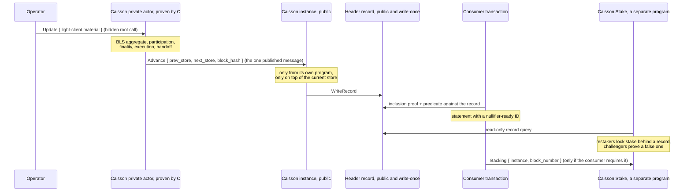
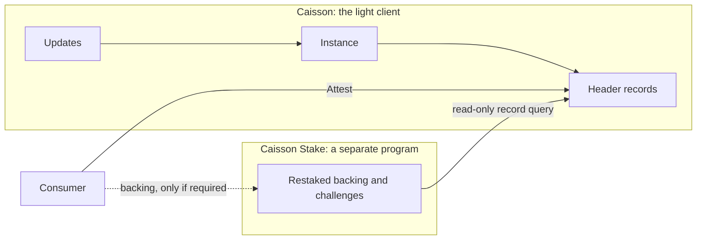

# Caisson: RFP-021 submission

Paste each block below into the matching field of the
[RFP proposal form](https://github.com/logos-co/rfp/issues/new?template=proposal.yml).
Replace every `TODO` first. The form's issue body is capped at 65,536 characters.

Evidence links are pinned to `vineetpant/lez-hello-world@eb686e9` and
`hu55a1n1/logos-explorations@d035841`.

---

## RFP ID

RFP-021 — Trustless Ethereum State Attestation for LEZ

## Your Project Name

Caisson

## Team or Organization Name

Congruence Labs

## Primary Contact

TODO (team): email, Telegram, Discord or Signal

## Team Members

Member 1
Name or pseudonym: Chirag Mahaveer Parmar
Social links: https://github.com/chirag-parmar
Role: TODO
Status: TODO

Member 2
Name or pseudonym: Shoaib Ahmed
Social links: https://github.com/hu55a1n1
Role: TODO
Status: TODO

Member 3
Name or pseudonym: Vineet Pant
Social links: https://github.com/vineetpant
Role: TODO
Status: TODO

Member 4
Name or pseudonym: Manas Nagaraj
Social links: https://github.com/hopinheimer
Role: TODO
Status: TODO

## Project Summary

A caisson is the sealed foundation a bridge pier is sunk on. Caisson is the verified anchor
that LEZ programs build on when they act on Ethereum, RFP-022's bridge among them.
Repository: [github.com/congruence/caisson](https://github.com/congruence/caisson), MIT and
Apache-2.0.

Any LEZ program that acts on Ethereum needs one primitive: proof that a fact holds on finalized
Ethereum, verified by LEZ itself, with no committee or oracle to trust. Caisson is that
primitive, as one LEZ 0.4 program.

- **One transaction per update, proven by the operator.** The sync-committee BLS12-381
  aggregate, the finality branch and the committee handoff are checked by the program itself
  (F.1), in a private actor of the program, inside LEZ's own execution proof. The sequencer
  verifies one receipt. A real mainnet update with a handoff costs **429,723 exec gas** and
  **224,063 storage gas**, against the 14.1M cycles the check itself takes. No job
  state spans transactions, and no precompile is needed.
- **Verified once, read by every consumer.** Each verified header is written once to its own
  immutable record account. Consumers prove inclusion and evaluate their predicate against one
  record, inside their own transaction (F.7), in a public or a private transaction.
- **Private attestation adds no correlation signal (F.8).** The query, the Ethereum proof and
  the predicate stay inside the consumer's proof. One message crosses to public state, a check
  that the record is held, from a one-time alias.
- **Any finalized block, from two updates a period.** Attestations reach the 8,191 blocks before
  any record through the EIP-2935 history contract, and further through a parent-hash chain. The
  instance needs only two updates per sync-committee period.
- **Built and measured.** A prototype runs this design end to end on a LEZ `v0.4.0-rc1` devnet
  (Bedrock, sequencer, indexer) with live mainnet data and real proofs: deploy, Init, a committee
  handoff, a finality update, and public and private attestations, including to older blocks.
  Every figure in this proposal comes from those runs.

## Technical Approach

### 1. Design Overview

**Components**

- **Caisson program:** a LEZ program, deployed immutable. On the operator's private account it
  runs the full update check (BLS aggregate, participation, finality, execution and handoff
  branches) inside the operator's proof. On public accounts it keeps each instance's
  configuration, consensus state, committees and finalised headers (section 4), and advances
  only on a message from its own program.
- **Finalised header accounts:** one per verified header, written once, never changed.
- **Consumer program:** proves an Ethereum fact against one record and acts on the statement.
- **Caisson Stake program:** a separate LEZ program with its own image ID. It holds stake
  positions, locks backing behind records and settles challenges. It reads Caisson's records and
  never writes them.

**Roles**

- **Operator:** fetches light-client updates through the Logos Ethereum core module, proves the
  program's update check, and submits one transaction.
- **Sequencer and indexers:** verify the receipt, run the small public part, and charge fees.
- **Restaker (Caisson Stake):** checks a header against Ethereum's own finality with its own
  node, then locks stake behind its record, forfeited in full if the header is proven false.
- **Challenger (Caisson Stake):** watches backed records, and proves a false one with a later
  record of the same instance and a history proof showing a different block hash.

Caisson Stake, restakers and challengers make up the restaking side, isolated from the light
client.

**Flow**



The heavy computation sits with the operator. The trust decision stays on LEZ: the proof must
be of the deployed, immutable program, and the instance accepts a new store only from its own
program and only on top of the store it holds.

### 2. Economic Analysis Of The Anchor

The light-client protocol's default anchor is the sync committee: 512 validators whose
signatures a light client follows instead of the full validator set. This section measures what
stands behind it, how much stake signs each header and how much of it a forger would lose, and
what Caisson adds to it.

**Stake behind a signed header.** Every seat is a validator with an effective balance between 32
ETH (the minimum to activate) and 2,048 ETH (the maximum since EIP-7251). A header needs 342
signatures, so in the worst case a minimal forgery is signed by 342 validators at 32 ETH each:
**10,944 ETH**. Real committees hold more; an example from mainnet closes this section.

**Today, nothing is burned.** The consensus spec has two slashable offences, proposer equivocation
and attester double or surround votes. Sync-committee messages aren't among them, and no fork
through Fulu adds one. A member that signs a fake header for a light client can still sign the
canonical root for its duty, so it doesn't even give up its sync reward, about 0.21 ETH per seat
per period (derived from EIP-8390's issuance figure).

**If sync-committee lies were slashable.** EIP-7657 would slash the signers of conflicting
sync-committee messages with the standard `slash_validator`. Under Electra that burns, per
validator, `effective_balance / 4096` at once, plus a correlation penalty of
`effective_balance × min(3 · S / T, 1)`, where `S` is all stake slashed within about 36 days and
`T` is total stake (about 43.7M ETH, October 2026). The validator is also ejected. In the worst
case, every signer at 32 ETH:

| Signatures the forgery needs | Stake that signs | Burned |
|---|---:|---:|
| 342, the protocol minimum | 10,944 ETH | **11 ETH** |
| All 512 | 16,384 ETH | **22 ETH** |
| 342 in each of two committees | 21,888 ETH | **38 ETH** |

`burned = S × (1/4096 + 3 · S / T)`. The burn is 0.10–0.17% of the stake that signs, because the
correlation penalty scales with the share of *all* stake slashed together. It only takes the
whole balance once a third of all stake is slashed at once, about 14.6M ETH. That is exactly the
Casper FFG case, and exactly what a 512-seat committee can never reach.

**How the anchors compare:**

> **EIP-8390** (draft, created 22 Aug 2026, no fork named) would remove the sync committee and have
> light clients verify a succinct proof of Casper FFG finality over the full validator set,
> moving every header to the FFG row below. Caisson would adopt that anchor as a new program
> version with new instances; records and statements already made stay valid.

| Anchor | Stake that signs a minimal forgery | ETH a forger loses |
|---|---:|---:|
| Sync committee, today | 10,944 | **0** |
| Sync committee, if slashable (EIP-7657, stagnant since 2024) | 10,944 | **11**, plus ejection |
| Casper FFG finality over the full validator set | at least a third of stake, ≈ 14.6M | **≈ 14.6M**: the correlation penalty takes all of it |
| Sync committee plus restaked backing `B` (Caisson Stake, D1) | 10,944 + `B` | **`B`, in full** (plus 11 if EIP-7657 ships) |

These figures are per header, not per consumer. One forged header exposes every consumer that
accepts its record at once, so what guards a header has to be weighed against the value all of
them place on it together.

**Decision D1: anchor on the sync committee, and ship a basic restaking program beside it that
adds the capital the committee lacks.** The sync committee and restaked stake defend against different attacks, and
each is weak exactly where the other is strong:

| | Sync committee | Restaked stake |
|---|---|---|
| Who signs | 512 seats drawn by RANDAO in proportion to stake, fixed a period ahead | Whoever chooses to lock stake behind a header |
| Against coordination | Strong: a forger must corrupt at least 342 seats spread across many operators it didn't choose | Weak on its own: backers self-select, so stake can concentrate in a few parties |
| Capital at risk | None today; 11 ETH in the worst case even with EIP-7657 | All of it, forfeited in full when a header is proven false |
| Liveness | Signs every slot as a protocol duty | Depends on backers choosing to lock stake |

So a header in the hybrid is trusted on two independent grounds: a randomly drawn
supermajority signed it, and stake that is lost in full if it is false stands behind it. A
forger then has to coordinate the committee and also put up, and lose, the backing.

Caisson anchors on the sync committee, as the light-client protocol and this RFP expect, and
adds restaking as a separate program, **Caisson Stake**, isolated from the light client. It only
reads header records, so advancing the sync committee, writing records and attesting work the
same with or without it, and consumers that don't require backing never touch it.



### 3. Advancing Finality

E1, by Shoaib Ahmed
([`logos-explorations/rfp-021/e1`](https://github.com/hu55a1n1/logos-explorations/tree/d035841b1efe484db91956eee2a9f47b305dcba3/rfp-021/e1)),
ran a real mainnet update with a committee handoff as a private LEZ `v0.4.0-rc1` transaction,
through the sequencer's own settlement code:

| Result | Figure |
|---|---|
| The update check, proven privately | **14,058,921 cycles** |
| Exec gas, through the block fee path | **429,723** (409,764 flat plus the 19,959-cycle public part) |
| Storage gas | **224,063** for the zk receipt |
| Proving (on Apple M3 Max) | 1,107 s, 13.1 GB peak |
| Proving (on RTX 4090, 24 GB, CUDA 12.4, r0vm 3.0.6 built with CUDA) | 30.2 s |

**Decision D2: the update runs in a private actor of the program, proven by the operator, and
lands as one transaction.** The check takes 14.1M cycles. LEZ `v0.4.0-rc1` caps exec gas at 10M
(`MAX_GAS_EXEC`), both for a single transaction's gas limit and for the total of a whole block,
so the check can't run as a public transaction. Run privately, the sequencer verifies one receipt
for a flat charge whatever the private part computed: 429,723 exec gas.
Running privately also keeps the load off the network. The 14.1M-cycle check runs once, on the
operator's prover. The sequencer and every indexer that replays the block only verify the receipt
and run the 19,959-cycle `Advance`.

### 4. Core Data Structures

Each account's object is Borsh-encoded, and stores the values its address is derived from, so it
can recompute its own address and refuse to act anywhere else.

| Object | Once per | Stored as | Passed |
|---|---|---|---|
| Instance configuration | Instance | Public PDA at the instance ID; written once, at `Init` | In `Init`, a public transaction |
| Consensus state | Verified update | Public PDA keyed by execution block number; written once, by the update that reached it | The operator names the state it builds on; a copy goes into `Update` as private input, the new state out in `Advance` |
| Committee | Sync-committee period | Public PDA, the root only; written once, at `Init` or its handoff | The 512 keys go into `Init` or `Update` as private input, checked against the root |
| Finalised header | Verified header | Public PDA; written once, by the update that finalised it | Public path: `Attest` is sent to it. Private path: private input to `AttestPrivate`, confirmed by `CheckRecord` |
| Predicate | Claim | Not stored | Inside the claim |
| Claim | Consumer transaction | Not stored | Public path: in `Attest`, visible in the transaction. Private path: private input to `AttestPrivate`, never published |
| Verified statement | Holding claim | Not stored | Public path: the `Attested` reply and event. Private path: returned inside the consumer's proof |
| Events | Update or public attestation | In the block's events, not in accounts | Emitted by the program's handlers |

Nothing is overwritten. Every account is written once and never removed, so a statement valid
when produced stays valid (R.3), and an unadvanced instance keeps every state and header it has
verified (R.7).

#### 4.1 Instance Configuration (F.9, F.13–F.15)

**Decision D3: the instance ID is the address `PDA(program, H(checkpoint ‖ config))`, where the
configuration account sits.** The address commits to its contents, so an instance can't be squatted with a weaker
configuration and anyone may initialise it. Mainnet, Sepolia and Hoodi instances coexist under
one program, each bound to its own chain (F.14, F.15).

```rust
// at instance_id = PDA(program, H(checkpoint ‖ chain ‖ finality))
struct InstanceConfig {
    checkpoint: Root,                // the beacon block root the instance starts from
    chain: ChainBinding,
    finality: FinalityParams,
}

struct ChainBinding {
    chain_id: u64,                   // execution chain
    genesis_validators_root: Root,   // consensus network
}

struct FinalityParams {
    genesis_time: u64,
    forks: Vec<(u64, [u8; 4])>,      // (activation epoch, fork version), oldest first
    min_participants: u16,           // 342 of 512
    weak_subjectivity_period: u64,   // seconds; past it the instance is replaced (F.10)
}
```

The account is written once and the program has no instruction that writes it again. A wrong or
stale checkpoint is replaced by a new instance (F.10). The Logos Ethereum core module's
checkpoint API checks the checkpoint here against public Ethereum sources.

#### 4.2 Consensus State

Each verified update writes a new consensus state, keyed by the execution block number it
finalised, and never changes an old one:

```rust
// at PDA(program, H("state" ‖ instance ‖ block_number))
struct ConsensusState {
    instance: AccountId,             // instance_id
    block_number: u64,               // the finalised execution block this state reached
    parent: u64,                     // block_number of the state the update was built on
    period: u64,                     // its sync-committee period
    current_committee: Root,
    next_committee: Option<Root>,    // once handed off
    finalised_header: AccountId,     // its FinalisedHeader account
}
```

An update names the state it builds on, is checked against that state's committee roots, and
writes the state for the block it finalises. A second update reaching the same block finds that
account written and is refused (R.8). Updates from one state to different blocks both stand,
each a verified state the next update can build on. A consumer goes from the block number it
already has to the state, and from there to the header. Each state holds roots and references
only, so its size is fixed. An update brings the committee's 512 keys as private input and the
program checks them against the stored root (section 8.3).

#### 4.3 Committees

`Init` and each verified handoff write the period's committee root to its own account:

```rust
// at PDA(program, H("committee" ‖ instance ‖ period))
struct Committee {
    instance: AccountId,             // instance_id
    period: u64,
    root: Root,                      // SSZ root of the 512 keys and their aggregate
    handoff_slot: u64,               // the attested header that carried it
}
```

Together these accounts are the verified handoff chain from the checkpoint forward, so anyone
can audit which committee signed any header.

#### 4.4 Finalised Headers

**Decision D4: each verified finalised header is written once to its own account,** keyed by
instance and execution block number, never rewritten or removed. It holds what an attestation needs and nothing
else:

```rust
// at PDA(program, H("header" ‖ instance ‖ block_number))
struct FinalisedHeader {
    instance: AccountId,             // instance_id
    chain: ChainBinding,             // a statement is refused on another chain or instance (F.5, F.15)
    slot: u64,
    beacon_root: Root,
    block_number: u64,
    block_hash: Root,                // history proofs start here (section 8.1)
    state_root: Root,                // accounts and storage slots (F.3)
    receipts_root: Root,             // logs (F.3)
    signers: u16,                    // of 512, so a consumer can require more than 2/3
    committee_period: u64,           // which committee signed
}
```

An attestation reads this one account and nothing else, so no action's cost grows with stored
state (P.9).

#### 4.5 Predicates

A predicate is a list of conditions on the values one fact establishes, all of which must hold
(AND). The consumer writes it, so a new question needs no change to the module (F.4).

```rust
struct Condition {
    subject: Subject,
    op: Op,
    rhs: [u8; 32],                   // uint, int (two's complement), address or bytes32, as a 32-byte word
}

enum Subject {
    AccountBalance, AccountNonce, AccountCodeHash,
    StorageValue { offset: u8, width: u8 },   // a packed field within the slot
    LogEmitter, LogTopic(u8), LogDataWord(u8), LogTopicCount, LogDataLength,
}

enum Op { Equal, NotEqual, Less, AtMost, Greater, AtLeast }   // F.4: at least = and ≠
```

A subject the fact doesn't carry is refused (`MalformedInput`), never read as zero.

#### 4.6 Claim

A claim is what the consumer asks in its own transaction (F.7): one or more facts to prove
against one finalised header, each with the predicate it must satisfy. Several facts make a
compound claim (soft #4).

```rust
struct Claim {
    chain_id: u64,                   // the chain the consumer expects; refused on another (F.5)
    facts: Vec<Fact>,                // each proven under the same header; all must hold
}

struct Fact {
    proof: Proof,                    // what is proven
    conditions: Vec<Condition>,      // what must hold of the values it establishes
}

enum Proof {
    Log { tx_index: u64, receipt: Vec<u8>, proof: Vec<Vec<u8>>, log_index: u64 },   // under receipts_root
    Storage { address: [u8; 20], account: EthAccount, account_proof: Vec<Vec<u8>>,
              slot: Root, value: Root, storage_proof: Vec<Vec<u8>> },              // under state_root
    Account { address: [u8; 20], account: EthAccount, account_proof: Vec<Vec<u8>> },
}
```

A log from a reverted transaction proves nothing and is refused (`ConditionUnsatisfied`). Every failure is a typed
refusal (U.5).

#### 4.7 Verified Statement

A claim that holds becomes a statement. It returns to the consumer inside the same transaction,
on both paths, and is not stored except on the soft #1 path (section 8.7).

```rust
struct Statement {
    instance: AccountId,             // instance_id: the instance whose header was used (F.15)
    chain_id: u64,                   // the chain it is about (F.5)
    block_number: u64,               // the block the facts were proven under
    facts: Vec<ProvenFact>,          // one per fact, in the claim's order
}

struct ProvenFact {
    class: Class,
    id: Root,
    conditions: Vec<Condition>,      // what was asserted of it
}

enum Class {
    Occurrence,                      // logs: one ID per event, safe as a one-shot nullifier
    State,                           // storage, account: same state, same ID at any block
}

// F.6: a hash of the Ethereum state each fact proves, and nothing else
id = SHA-256("eth_lc/statement/v1" ‖ chain_id ‖ kind ‖ fields)
//   storage  (0): address ‖ slot ‖ value
//   log      (1): block_hash ‖ tx_index ‖ log_index ‖ emitter ‖ n_topics ‖ topics ‖ len(data) ‖ data
//   account  (2): address ‖ nonce ‖ balance ‖ code_hash
```

The ID leaves out the conditions, the header used, the instance, the path and the proof bytes.
Two consumers asking different questions about one deposit, an instance and its replacement,
and the public and private paths all give one fact the same ID, so it can't be consumed twice
through any of them. Fixed widths, length prefixes and the kind tag make the encoding injective,
so distinct state gives a distinct ID.

**Decision D5: each fact's ID carries a nullifier-safety class (F.6, S.4).** The kind tag
separates the classes, so they never collide. An occurrence ID is one per event, so it is safe
as a one-shot nullifier. A state ID is the same at any block, as F.6 requires, so the same value
at two times gives the same ID; it is safe as a one-shot nullifier only for state written once.
Nullifiers belong to the consumer: a consuming program keeps them in its own accounts, keyed by
the fact's ID, and checks the class first.

#### 4.8 Events

Following LP-0012, so that operators and indexers follow an instance without polling accounts:

```rust
enum Event {
    CommitteeHandoff { instance: AccountId, period: u64, committee_root: Root },   // instance: instance_id
    HeaderFinalised { instance: AccountId, block_number: u64, header: AccountId }, // instance: instance_id
    Attested { statement: Statement },   // public path only; a private attestation emits nothing
}
```

### 5. Attestations

The `eth_lc` prototype, by Vineet Pant
([`lez-hello-world/rfp-021/results.md`](https://github.com/vineetpant/lez-hello-world/blob/1b8b5cb42ac955aa7f35e9ff6e529fe08c1ea48c/rfp-021/results.md)),
ran public and private attestations of a WETH storage slot on a LEZ `v0.4.0-rc1` devnet against
live mainnet, with real proofs.

**A public consumer transaction** runs the claim on the sequencer: the Merkle-Patricia check and
the conditions, against one finalised header, inside the consumer's own transaction. Nothing
needs proving on the consumer's machine.

| Public attestation | Exec gas | Storage gas |
|---|---:|---:|
| Storage slot with its account | **301,115** | 7,514 |
| Account | TODO | TODO |
| Receipt log | TODO | TODO |
| Each extra condition | TODO | TODO |

**A private consumer transaction (F.8)** proves the same check on the consumer's own machine:

- The claim, the Ethereum proof and the conditions are checked inside the consumer's proof.
- One message crosses to public state: `CheckRecord { instance, header }`. It is a synchronous
  call to the account of the finalised header the claim was proven against, at
  `PDA(program, H("header" ‖ instance ‖ header.block_number))`. The account accepts the message
  only from the Caisson program's own actors, and refuses it unless the header it holds equals
  `header`. The message carries nothing about the claim.
- The sender presents a fresh alias for each message, so the consumer's account is never
  published and two attestations by one consumer can't be linked through it. Refunds go to the
  fee payer's blinded alias, never to a public account.
- Finalised headers are immutable, so a header held when the consumer proves is still held at
  inclusion, and several private attestations can land in one block (R.11).
- What is published: the program, the instance, which finalised header was used, and the time.

| Private attestation | Exec gas | Proving | Peak memory |
|---|---:|---:|---:|
| Storage slot with its account | **430,045** | 873.2 s | 7.3 GB |
| Account | TODO | TODO | TODO |
| Receipt log | TODO | TODO | TODO |

Every private attestation pays 409,764 exec gas to verify its receipt plus its public cycles
(20,281 for the storage slot, the `CheckRecord`), and 224,063 storage gas for the zk receipt.

*Ref. Apple M3 Pro, 18 GB, proving on CPU.*

**The Merkle-Patricia check alone.** Outside LEZ, the same checks run as a RISC Zero guest on
recorded mainnet (block 26376237), with one condition each
([`caisson/experiments/mpt-zkvm`](https://github.com/congruence/caisson/tree/main/experiments/mpt-zkvm)):
executed for the public path's cycles, and proven to a succinct receipt for the private path.

| Check | Public: cycles | Of which, the check | Input | Proving | Peak memory |
|---|---:|---:|---:|---:|---:|
| Account | 153,931 | 135,599 | 4,028 B | 46.0 s | 5.2 GB |
| Storage slot with its account | 270,062 | 244,617 | 7,104 B | 59.4 s | 5.9 GB |
| Receipt log | 61,074 | 49,801 | 1,743 B | 39.6 s | 4.8 GB |
| Each extra condition | +507 to +589 | — | +33 B | — | — |

The rest of each public figure is reading the input. Each receipt is 223,362 bytes.

*Ref. Apple M4 Pro, 14 cores, 48 GB, proving on CPU with `r0vm` 3.0.5.*

**Minimum spec for a private attestation (P.4).** 7.3 GB peak and 14.6 min on the reference
laptop. We declare 16 GB of RAM, CPU proving, with a light desktop load, as the supported minimum.

### 6. Misbehavior And Freezing

The sync protocol moves its finalized header to any newer slot that a supermajority of the current committee signed. It skips any ancestry check between the old header and the new one. Sync-committee signatures sit outside Ethereum's slashing rules, so a second chain costs the signers only the signatures. We freeze an instance when someone brings evidence that the committee the instance trusts signed a header that conflicts with one the instance stored (AKA equivocation).

#### 6.1 Evidence

Evidence of misbehaviour can be submitted in its own `Evidence` message. The message carries one light-client update plus the address of the stored account it conflicts with. It is very similar to `Update` except it checks against an older stored account and writes only the `Freeze` account.

The instance keeps one header per execution block number and one committee per period. Evidence names the stored account by that key.

| Evidence against the stored state | What we do |
|---|---|
| Stored header at the same block number, different `block_hash` | Freeze |
| Stored header at the same block number, same hash, same slot, different `beacon_root` | Freeze |
| Next committee for a period whose `Committee` account holds a different root | Freeze |
| Header at a new block number | Apply as an update. Its ancestry is checked once the `block_roots` proof ships |
| Stored header at the same block number, same hash, later slot | Ignore. Two Gloas slots name one execution block |
| Optimistic head, LMD reorg, or the spec's force-update | Ignore. The core accepts finalized headers with a finality proof only |
| Same beacon root, different `signature_slot` | Ignore. The signature covers the attested root only |
| Evidence after its deadline | Reject. The instance stays live |

Each freeze row is one account lookup: the header account stores `block_hash`, `slot` and `beacon_root`, and the committee account stores the root of its period.

The lookups leave one gap. A fork at a new block number inside one period matches neither lookup, so the instance applies it as an update. The fix is a `block_roots` proof on the evidence transaction (one header's beacon state holds a different root at the other header's slot). `block_roots` covers 8,192 slots, i.e. one sync-committee period, and the branch is small next to the aggregate check. The same proof covers a fork at the same slot with a different block number. It ships after the lookups. Until then, detection covers the three freeze rows above.

#### 6.2 Deadline

Evidence must land before the update deadline of the stored side it conflicts with: the stored header's slot, or the committee's handoff slot, plus `weak_subjectivity_period`. The evidence transaction sets `timestamp_window(..deadline)`, the same bound `Update` uses. After the deadline, the committee's keys are expired, and a leaked key could sign a conflict for free. The deadline keeps such late evidence from halting a healthy instance. The LEZ sequencer clock sets the window, as the trust model already states: a late clock extends it, and an early clock closes it.

#### 6.3 Freeze

A valid piece of evidence writes one `Freeze` account at a PDA of the instance. Every `Update`, `hand_off` and `Attest` reads that account and proceeds only while it is empty. This adds one fixed read per transaction, so an attestation reads two accounts (P.9). The read stays constant as history grows.

Freezing stops the instance and leaves every stored account in place. It names the conflict and leaves the choice of chain to consumers. A consumer moves to a new instance, anchored at a checkpoint before the conflict that `verify_new_checkpoint` accepts.

### 7. Errors (U.5)

Every refusal has one code, the same in the program, the CLI's dry run and the docs:

| Failure mode | Code |
|---|---|
| Header not finalized | `UnfinalizedHeader` |
| Sync-committee signature invalid | `InvalidSignature`, `InsufficientSigners` |
| Committee handoff not verified | `UnverifiedHandoff`, `InvalidCommitteeProof`, `CommitteeKeysMismatch` |
| Checkpoint stale or wrong | `StaleStore`, `CheckpointRootMismatch` |
| Inclusion proof invalid | `InvalidInclusionProof`, `InvalidExecutionProof` |
| Predicate not satisfied | `ConditionUnsatisfied` |
| Chain-ID mismatch | `WrongChain` |
| Malformed input | `MalformedInput` |
| Update already applied | `UpdateNotNewer` |

**Dry run (U.2, R.2).** The CLI runs the same `statement::check` the program does before
submitting, so a refused claim returns the program's own error code (`InvalidInclusionProof` for
a tampered proof, `ConditionUnsatisfied` for a false claim) and is never submitted. A refused
private attestation can't be proven, so it costs nothing.

### 8. Optimizations

The core design above is complete on its own. These reduce what it costs to run and to use.

#### 8.1 History Through EIP-2935, With A Parent-Hash Fallback (Soft #3)

**Decision D6.** An attestation can target any finalized block, not only a recorded one.

A claim on an older block is sent with an ancestry proof, which takes it from a finalised header
back to the target block:

```rust
struct Ancestry {
    eip2935_proof: StorageProof,     // the history contract's slot for the target, under the header's state_root
    target: u64,                     // the target block number; fixes which slot the proof must open
    target_header: Vec<u8>,          // the target's RLP header; must hash to the block hash the proof gives
}
```

- **The 8,191 blocks before a record:** the EIP-2935 history contract, live since Pectra on
  mainnet, Sepolia and Hoodi, keeps those block hashes in state. A storage proof under the
  record's `state_root` gives the target's hash; the target's RLP header, which must hash to
  it, gives its roots.
- **Any distance:** a chain of headers from the record back to the target, each checked
  against its child's `parentHash`. It depends on nothing but header hashes, so it also covers a
  chain without EIP-2935 (F.14).
- **Older than that:** beacon `historical_summaries`.

*Evidence (node, real proofs, 6 Nov):*

| Target | Public consumer | Private consumer |
|---|---:|---:|
| The record's own block | 1,820,152 | 5,238,752 |
| 1,000 blocks back, EIP-2935 | 3,288,376 (397k exec gas) | **5,238,752** |
| 3 blocks back, parent-hash chain | 2,507,576 (303k exec gas) | **5,238,752** |

A private attestation reaches an older block at no extra charge: the history proof is checked
inside the consumer's proof and the published part is the same `CheckRecord`. A forged history
header was refused in both (`BadExecutionBranch`). Natively, six tests on pinned mainnet blocks
cover EIP-2935 and the parent-hash chain and refuse a forged header, the wrong slot, another
contract, a target outside the window, a broken link and the wrong anchor.

#### 8.2 Two Updates Per Sync-Committee Period

**Decision D7.** The instance takes the mandatory handoff plus one update about 13.7 h later,
642 a year. Consecutive records stay inside the 8,191-block history window, so every block
between them is provable from the later one. An event newer than the latest record gets an
on-demand update, paid by whoever needs it.

*Derived:* tracking costs about 11.3M a period at the floor base fee, about 0.001% of the
period's exec capacity, shared by every attestation in it. Records grow 118 KB a year, 591 KB
over five years; the instance doesn't grow (P.3, P.7).

#### 8.3 Committee By Root; Keys Only As Private Input

The instance stores each committee as its 32-byte SSZ root. The 512 keys arrive in the update's
private input and are hashed against the root inside the proof, so they never touch public
state or storage gas. The signing key is the committee aggregate minus the non-signers.

#### 8.4 Proving On Modest Hardware

Proving at a smaller segment size brings an update's peak memory down to 3.9 GB, at about 48
minutes on the reference laptop, against 36–38 minutes and 8.6–9.3 GB at the default size.
Operators choose the trade: an 8 GB
laptop can operate the module, and a GPU or delegated prover (section 8.5) cuts the time.

#### 8.5 Delegated Proving

A prover can't forge an update; it can only fail to produce one. The update's program proof,
about 760 of E1's 995 s, takes only public update material, while the privacy circuit's proof,
about 233 s, needs the submitter's keys. The operator daemon (M3) can send the first to a remote
or GPU prover and keep the second local.

#### 8.6 Catch-Up In One Transaction (R.7)

One private execution verifies several consecutive periods, so a stalled instance resumes in
one transaction with no gap in the handoff chain. Delivered and measured in M1.

#### 8.7 Recorded Statements And Batching (Soft #1, #2, #4)

- **Recorded statements.** `Record` runs the same `evaluate` as `Attest` and writes the statement
  to a write-once account derived from the instance and the statement ID. One verification
  core, so one audit surface. A reader trusts the program, not whoever paid for the write, but
  acts on a result from an earlier transaction, which the direct path never asks; the docs say
  so. Recorded statements are public by design.
- **Batching.** `Attest` and `Record` take a list of queries over one record: the record is read
  once, and each query adds only its own proof and predicates. A private batch is one proof and
  one `CheckRecord` for all of them.
- **Compound statements (soft #4):** AND over several proofs under one header in one statement.

All three are delivered in M2, with their costs measured.

### 9. Operator Daemon And Operator Incentive (U.3, R.4, R.5, R.9, R.10, Soft #5)

The daemon is a Logos module plus a Logos Core headless CLI. It follows Ethereum through the
Logos Ethereum core module and tracks the instance from LEZ events (LP-0012).

- **Re-check before submit (R.9).** A losing racer pays its whole reserve (E1), so the daemon
  re-reads the instance immediately before sending and keeps its reserve tight.
- **Deferral (R.10).** A per-instance randomized delay spreads cost across operators; its effect
  on latency is documented.
- **Restart (R.4, R.5).** The daemon resumes from the instance on LEZ, never re-verifies from the
  checkpoint, and never repeats applied work.
- **Requirements (S.7).** No standing on Ethereum and no registration: only a consensus
  endpoint and LEZ gas. The operator proves on its own CPU; the measured minimum is section 8.4.

**Decision D8: a staleness bounty (soft #5).** Each instance has a bounty pool, a PDA of the
program seeded by the instance ID, funded by anyone with an ordinary transfer. A successful
`Advance` pays the recipient it names `min(pool, rate × Δslots, cap)` through
`custody_transfer`, where `Δslots` is how far the new finalized header is past the previous one,
proven by the update itself. `rate` and `cap` are immutable instance config. The payout grows
with staleness, so operators with different costs act at different moments instead of racing,
and tiny frequent updates earn tiny payouts. There's no registration (F.11); whoever lands the
`Advance` is paid. An unfunded pool pays nothing, and liveness never depends on it.

### 10. Reuse (R.6)

TODO (team): name the base the build uses.

Every figure in this proposal ran on `sextant-core`, the light-client verifier from the Sextant
prototype ([edenbd1/lez-sextant](https://github.com/edenbd1/lez-sextant), MIT OR Apache-2.0),
vendored unmodified, and the prototype's program design follows Sextant's LEZ v0.3 program. The delivered module's
light-client core is chosen in M0 against the audited alternatives, on fixed criteria:

| Candidate | Audited | Fit with LEZ |
|---|---|---|
| `r0vm-helios` | yes, by zkSecurity | Same zkVM (RISC Zero). Targets EVM destinations, so the LEZ actor, records and attestation are ours |
| Helios `consensus-core` | upstream of the audited forks | Plain Rust; adapted to run inside a LEZ actor |
| `sextant-core` | no | Already runs as a LEZ v0.4 actor |

Criteria: Electra, Fulu and Gloas coverage; whether the audit covers the code paths the program
runs; its cycles under LEZ's metering, re-measured with the same runs; and the work to fit the
actor model. Primitives: BLS12-381 through RISC Zero's accelerated `blst` and `bls12_381`,
SHA-256, Keccak, SSZ and Merkle-Patricia proofs. Reused audited code on audited paths leaves
the audit (M5) with the LEZ-specific code: the actor and its trust boundary, records,
statements, predicates and inclusion proofs. Code outside an existing audit joins that scope.

### 11. Security Model (S.6, VS.1–VS.6)

- **Fabricated chain (VS.1),** tested explicitly. A fabricated execution state root is committed
  in the finalized header, that header in the attested state, and the attested header is signed
  by all 512 keys of a committee we generated. Refused: `CommitteeMismatch`. The control: against
  a store that trusted that committee, the same update verifies, so the refusal comes from the
  committee chain back to the checkpoint. A fabricated checkpoint header: `CheckpointMismatch`.
- **Every VS.2 rejection, tested:** a committee never handed off (`HandoffNotVerified`), a
  forged next committee (`BadCommitteeBranch`), 341 of 512 signers (`BelowParticipation`), a
  header not finalized (`NotFinalized`), a tampered state or receipts root (`BadExecutionBranch`;
  `BadInclusion` against a record), a proof replayed to another chain (`ChainMismatch`; an update
  under another chain's domain, `BadSignature`), and a predicate over state the proof doesn't
  cover (`Malformed`; another slot, `BadInclusion`). 13 native tests on recorded mainnet vectors,
  each next to an honest control that passes. The attestation cases were also refused on the
  node. In M1 the whole suite runs through the deployed program.
- **VS.6:** an update is accepted on proof validity alone. The submitter's account is never
  checked; E1 settled updates from blinded senders.

#### 11.1 Failure Modes (VS.4)

A consumer bounds its exposure with four defences, all enforced in its own transaction: a signer
threshold above the protocol's 342, read from the record's signer count; the two-committee rule,
acting only on a header the next committee has also built on; a value cap per header or period;
and a freeze authority of its own, as RFP-022 specifies for the bridge, which can't censor other
consumers or touch tracked state.

A compromised committee can get a never-finalized header recorded and make false statements
verifiable from that record on. It can't alter existing records or consumed statements, or move
the checkpoint or config. Recovery is a fresh instance from a checkpoint before the attack. The
Recommended Consumer Pattern (S.4) also pins this module's program ID and instance in the
consumer, never in mutable state (VS.3).

**Off-chain participants (F.12)**

| Participant | Does | Affects | If it declines or misbehaves |
|---|---|---|---|
| Checkpoint supplier (`Init`) | Chooses the checkpoint and config | **Safety**, once | Consumers verify the checkpoint through the core module's API (F.9) before binding; a bad instance is replaced, never fixed in place |
| Beacon API source | Serves updates and committee keys | Liveness | Everything it serves is verified; any beacon node serves the same data |
| Operator | Proves and submits updates | Liveness | Anyone can operate, with no registration (F.11); proving is delegable (section 8.5) |
| Execution RPC | Serves `eth_getProof` and receipts | Liveness | Every proof is checked against a verified record |
| Consumer's prover (private) | Proves the consumer's own transaction | Liveness, that consumer only | No third party sees the query |
| Relayer (optional) | Submits a consumer's attestation | Liveness | The consumer submits directly |
| Sync committee | Signs headers | **Safety**: honest supermajority | Stake at risk in section 2; consumer defences in 11.1 |
| Restaker (Caisson Stake, D1) | Locks stake behind a record after checking it against Ethereum's finality | **Economic safety** for consumers that require backing | Backing a false header forfeits its stake in full; declining leaves those consumers waiting for other backers |
| Challenger (Caisson Stake, D1) | Proves a backed record false within its challenge window | **Safety** for consumers that require backing: at least one must act | Anyone can challenge, and a challenge is a proof, not an accusation, so it can't be false |

Only the checkpoint supplier and the sync committee affect safety, and every liveness role can
be filled by anyone, so no party alone or as a class can stop an attestation from eventually
being produced. With Caisson Stake, consumers that act on backing additionally rely on at
least one honest challenger acting within each record's window, which anyone can be.

### 12. Platform Dependencies, Checked Against The Live Runtime

| Dependency | Status | Handling |
|---|---|---|
| LEZ testnet 0.4 (S.1) | `v0.4.0-rc1` tagged 29 Oct; the public testnet isn't live yet | Built and measured on the rc and a local v0.4 devnet (S.2); deployed to testnet 0.4 in M4; every benchmark is scripted and re-run on the final 0.4 |
| Standalone sequencer and Bedrock (S.2) | No published Bedrock release matches v0.4's pin | Built from source at the pinned commit; deploy, Init, updates and attestations ran on this devnet 3–6 Nov |
| SPEL IDL (U.4) | SPEL `v0.7.0-rc.3` supports neither LEZ v0.3 nor v0.4 (spel#291) | SPEL-format IDL written by hand, with a drift check in CI |
| Logos Ethereum core module | Doesn't expose light-client objects or raw `eth_getProof` nodes | Extended upstream by Chirag Mahaveer Parmar, who worked on the Nimbus verified proxy it wraps (U.1, F.9) |
| LP-0012 events | Delivered | The daemon and indexers follow handoffs and records from events |

### 13. Performance Summary (P.1–P.9)

| Req | Result |
|---|---|
| P.1 | Attestation fits one transaction: 52–190k cycles, 397k reaching 1,000 blocks back |
| P.2 | Per action: cycles, gas, proof time and proof size above, reproducible from the scripted runs |
| P.3 | Tracking about 11.3M a period at the floor base fee, two updates a period |
| P.4 | Updates: 36–38 min, 8.6–9.3 GB at the default segment size; 3.9 GB at 2^18. Private attestation: 12.5–14.6 min, 7.5–9.0 GB; declared minimum 16 GB |
| P.5 | A block before the latest record: no update wait. A newer event, on demand: about 13 min finality, up to 6.4 min for the update to appear, 36–38 min proving; about 49–57 min on the reference laptop, 30–36 min on an M3 Max |
| P.6 | Operator: one CPU prover, 8.6–9.3 GB at the default segment size, two proofs a period |
| P.7 | 118 KB a year, 591 KB over five years; the instance is constant |
| P.8 | The update check is 12.8M cycles: pairing 7.84M (61%), hash to G2 1.18M (9%), the two committee roots 1.09M each, decoding 1.31M. A pairing precompile would remove most of it, but it would be reachable only from public transactions, and Caisson proves the check privately, so it needs none |
| P.9 | Every action reads one record account by its derived address |

### 14. Traceability Matrix

| Req | Design | Evidence |
|---|---|---|
| F.1 | Program checks the aggregate in its proven actor (D2) | E1 real proof on a mainnet update; node runs |
| F.2 | Finality branch plus participation | `NotFinalized`, `BelowParticipation` tests |
| F.3 | Account, storage and receipt-log MPT bound to the record | Node: slot accepted, tampered proof refused; inclusion tests |
| F.4 | Consumer-written claim (section 4.5) | Consumer-defined predicate test, no module change |
| F.5 | `chain_id` in instance, record and statement | `ChainMismatch` test; mainnet and Sepolia cross-rejected (M2) |
| F.6 | ID classes (D5) | Equal-state and distinct-state tests |
| F.7 | Attest inside the consumer's transaction | Node runs; reference consumers (M2) |
| F.8 | One `CheckRecord` from a blinded alias | Node: transaction searched, nothing linkable published; full state diff (M2) |
| F.9 | Write-once instance configuration (D3); checkpoint API | Immutability test; core-module API (M3) |
| F.10 | Fresh instance on staleness | `CheckpointStale`; migration doc |
| F.11 | Any account advances | Blinded senders settled (E1); fresh-account test |
| F.12 | Participant table (section 11) | Trust document |
| F.13 | No rewrite instruction; immutable deployment | Interface review; loader refuses `UpdateHeader` |
| F.14, F.15 | `H(checkpoint ‖ config)` instances | Mainnet, Sepolia and Hoodi coexisting (M4) |
| U.1–U.3 | Logos modules, CLI, daemon | Module catalog, CLI docs |
| U.4 | Hand-written SPEL IDL | Drift check in CI |
| U.5 | Typed errors | Node: dry run returns the program's code |
| U.6 | ERC-20 and native-ETH vault consumers | e2e tests |
| R.1, R.2 | Deterministic attest; dry run | Repeat-verdict test; refused private attest submits nothing |
| R.3 | Immutable records (D4) | Node: written once, read back |
| R.4, R.5 | Daemon resumes from LEZ state | Kill and restart tests |
| R.6 | Reuse (section 10) | M0 decision log entry |
| R.7 | Catch-up (8.6) | Stall test |
| R.8 | `Advance` refuses an update proven on another store | Racing test (E1) |
| R.9, R.10 | Re-check and deferral | Multi-operator test |
| R.11 | Immutable records, no shared writes | Same-block private attest test |
| R.12 | CI | Green default branch |
| P.1–P.9 | Section 13 | Scripted benchmarks |
| S.1, S.2 | Testnet 0.4; standalone-sequencer e2e | Deployment; CI |
| S.3–S.7 | Integration, consumer-pattern, operator and trust docs | Docs in repo |
| S.8 | Audit | M5 |
| S.9, S.10 | Own module catalog via the release action | Release |
| S.11 | Decision log D1–D8, kept current | `docs/DECISIONS.md` |
| VS.1, VS.2 | Adversarial suite | 13 native tests; attestation cases refused on the node |
| VS.3–VS.6 | Sections 2, 4, 11 | Immutability; consumer pattern; trust document |
| Restaking (D1) | Caisson Stake, isolated, reading records through a read-only query | Tests: a forged record's backing forfeited, an honest record's released after its window, Caisson's updates and attestations work without Caisson Stake deployed (M3) |
| Soft #1, #2, #4 | Section 8.7 | M2 |
| Soft #3 | Section 8.1 | Node runs; 6 native tests |
| Soft #5 | D8 | M3 |

### 15. Risks

- **Private fee constants are provisional.** LEZ marks `PRIVATE_VERIFY_GAS` `FIXME: Provisional`.
  If private work were metered, D2's advantage would shrink. Every benchmark is scripted, so the
  cost is re-measured on the final 0.4 in M4.
- **Latency for an event newer than the latest record:** about 49–57 min end to end on the
  reference laptop, most of it proving. GPU or delegated proving (8.5) is the lever; finality
  time is the protocol's.
- **Operator hardware:** 36–38 min and 8.6–9.3 GB per update on the reference laptop, 3.9 GB at
  a smaller segment size.
- **Testnet 0.4 timing:** not live yet. Everything through M3 runs on the rc and a local devnet;
  if the launch slips past M4, the deployment moves with it.
- **The sync committee may be removed.** EIP-8390 (draft, no fork named) would replace it with
  ZK proofs of FFG finality over the full validator set. Sync-committee light clients, Caisson
  included, would stop advancing after that fork. Caisson would move to the new anchor as a new
  program version with new instances, the migration path of section 4.1; records and statements
  already made stay valid, and consumers rebind.
- **Liveness:** a missed handoff stops an instance until someone submits it. Mitigations: several
  operators, alerting, on-demand submission, catch-up (8.6). A missed mid-period update costs
  latency, never safety: blocks in the gap stay reachable through the parent-hash chain.

## Milestones, Payout and Timeline

TODO (team): a USD payout and a duration for each milestone. The build totals 8–12 weeks plus
the audit.

| # | Milestone | Weeks | Payout (USD) | Deliverables |
|---|---|---|---|---|
| M0 | Cost baseline | 1 | TODO | Update and attestation numbers on `v0.4`, laptop and GPU, the reuse decision (section 10), reviewed with Logos before the build |
| M1 | Verifier core and updates | 3 | TODO | Gloas-aware light client in the proven update, Init, immutable instances, records with signer counts, catch-up, VS.1–VS.2 through the deployed program, decision log |
| M2 | Attestation | 2 | TODO | Public and private attest, the full predicate interface and statement IDs, recorded statements, batching and compound statements, ERC-20 and native-ETH reference consumers, F.8 state-diff evidence, P.4 numbers |
| M3 | Ethereum side and operations | 2–3 | TODO | Core module extensions, F.9 checkpoint API, daemon (Logos module plus headless CLI) with re-check, deferral and delegated proving, CLI with dry run, staleness bounty, Caisson Stake and the public record query (D1) |
| M4 | Testnet and release | 2 | TODO | Testnet 0.4 deployment against a public Ethereum testnet, benchmarks re-run on the final 0.4, e2e CI on a standalone sequencer, docs, trust-assumptions document, module catalog release |
| M5 | Audit | — | TODO | Third-party audit of the consensus and inclusion logic, fixes, published report. Caisson Stake is a separate image and is scoped as its own audit line |

## Total Requested Budget (USD)

TODO (team): the sum of the milestone payouts above.

## Relevant Experience

- **Chirag Mahaveer Parmar** ([chirag-parmar](https://github.com/chirag-parmar)) builds the
  Nimbus verified proxy in `nimbus-eth1`, which the Logos Ethereum core module wraps: 68 merged
  pull requests, among them its REST-based light client, light-client scoring across multiple
  endpoints, EIP-2935 anchor jumps and `BLOCKHASH`, Gloas updates, and its C, Go and WASM
  bindings. He fixed `eth_getProof` in `nim-web3` and optimised RLP in `nim-eth`, and was an
  Ethereum Protocol Fellow (cohort five). The upstream extensions this proposal needs from the
  core module (light-client objects, raw `eth_getProof` nodes, the F.9 checkpoint API) are
  changes to code he maintains.
- **Shoaib Ahmed** ([hu55a1n1](https://github.com/hu55a1n1)) worked on Cosmos IBC at Informal
  Systems, where each chain verifies the other's consensus with an on-chain light client: the
  model Caisson follows on LEZ. In `ibc-rs` (then inside `hermes`, 59 merged pull requests) he
  implemented the light-client extraction (ADR 011) that separated light clients from the IBC core, and
  he contributed to `basecoin-rs`. He was lead developer of Quartz, a TEE framework whose
  enclaves verify the chain through a light client, and of Cycles, with arkworks settlement
  circuits and nullifier derivation; he now works on Shielded Labs' Zeronym. He did the research and E1 behind this design
  ([`logos-explorations`](https://github.com/hu55a1n1/logos-explorations/tree/d035841b1efe484db91956eee2a9f47b305dcba3/rfp-021/e1)),
  which proved a real mainnet sync-committee update as one private LEZ v0.4 transaction.
- **Vineet Pant** ([vineetpant](https://github.com/vineetpant)) worked on decentralized and
  self-sovereign identity at evan.network (`vade-evan`, `didcomm-rs`): verifiable credentials and
  presentations that reveal only chosen attributes, the problem F.8 poses. As an Ethereum
  Protocol Fellow (cohort six) he built dVRPC, a decentralized verified RPC node for Ethereum with
  an integrated light client, and he has contributed to Reth and Ream. He built the `eth_lc`
  prototype and ran its measurements on a LEZ v0.4 devnet
  ([`lez-hello-world`](https://github.com/vineetpant/lez-hello-world/tree/eb686e9a0b2a8cef05f0017aa9eb694ad5212346)).
- **Manas Nagaraj** ([hopinheimer](https://github.com/hopinheimer)) is a developer at Sigma Prime
  on Lighthouse, the Rust Ethereum consensus client, and a former Ethereum Protocol Fellow. His
  merged Lighthouse work includes Gloas support (payload-attestation gossip verification,
  backfill, builder onboarding) and fork-choice updates, and he has contributed gossipsub 1.2 to
  rust-libp2p. Caisson verifies the consensus objects he works on in a production client: beacon
  headers, sync-committee branches, SSZ roots and the fork schedule, Gloas included.

## Post-Delivery Plan

TODO (team): owner, and the period for which Congruence Labs operates an update daemon for the
reference instance, inside the budget.

## Permissions and Consent

- [ ] Logos may contact us using the primary contact above (required)
- [ ] Logos may use information from this proposal publicly (optional)

## Program Requirements

- [ ] We have read and agree to the Logos RFP Terms and Conditions (required)
- [ ] RFP specifications are proposals, not instructions; we are responsible for what we build, deploy or operate (required)
- [ ] The project is open-sourced under MIT and Apache 2.0 (required)
- [ ] We are prepared to deliver milestone-based outcomes (required)
